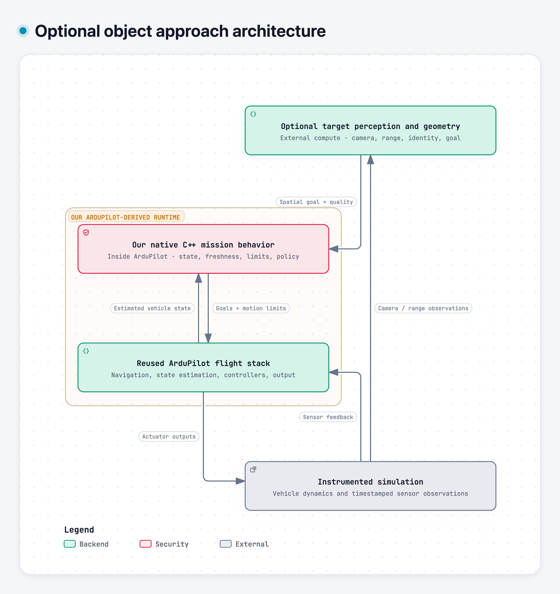

# FeatherLane AI mission and smooth approach design

Engineering explanation for project discovery

Recorded 31 October 2026

We are building a flexible mission system: a mission can navigate to a supplied GPS/local coordinate or use optional perception to find an object and approach a reachable stopping region beside it. Both use continuous vehicle-state feedback. Our maintained ArduPilot-derived code will execute the in-flight mission logic natively in C++. ArduPilot supplies the underlying flight capabilities; our additions define bounded, observable tasks and connect optional target understanding to mission execution.

The helicopter is one initial visual example, not the system's required target class. The first visual demonstration uses the static helicopter in FPV.SkyDive. That game uses a separate screen/input adapter. The measured autonomy work belongs to instrumented ArduPilot simulation. The helicopter is a landmark to approach without contact, rather than an aircraft to intercept. Moving-target pursuit and physical flight are outside the initial scope.

This document explains the AI we intend to integrate, what we build ourselves, what we reuse, the mission lifecycle, and the detailed process for smooth movement and stopping. Design examples are simulation illustrations, not qualified settings or observed performance.

## 1 Current decisions and evidence

**Confirmed direction:** ArduPilot, macOS development, a maintained ArduPilot-derived codebase, bounded native C++ in-flight mission logic/supervision, and mission-selected optional perception. Our custom behavior will reuse upstream estimation, navigation, controllers, mission facilities and configured failsafes. Upstream changes will be reviewed and requalified before adoption.

**Proposed details:** candidate `FL_Mission` and `ModeFeatherLane` modules; detector/model selection; sensor/depth source; input/status message mapping; scheduler budgets; simulator versions; and exact stopping/clearance thresholds. These choices are not implemented or qualified by being written here.

**Existing evidence:** a separate SkyDive prototype uses selected-region tracking, HUD decoding and native key scheduling. One saved continuous approach was visually reviewed as close to the helicopter. It does not establish semantic helicopter recognition, metric distance, controlled hover, repeatability or obstacle avoidance. A later user-reported contact remains unresolved. The available unrelated vehicle-detector weights do not contain a helicopter class.

**This project's status:** P00 documentation baseline complete; L01 source acquisition/orientation complete; P01 in progress; P02 through P08 planned; P09 optional hardware qualification. The [L01 record](evidence/l01-source-and-orientation/README.md) pins the unchanged source; no executable application, trained detector, custom firmware or qualified flight result exists here. Consult the live registry/L01 record for current execution and qualification status. Detailed diagram layouts and the UI are not approved merely by confirming the project direction.

## 2 What ArduPilot already does

The key reuse decision is to retain the system that turns a feasible navigation reference into controlled vehicle movement. We add task meaning and mission policy around those capabilities, inside our native extension where appropriate. We do not start by training a neural network to command motors.

| Capability | Existing foundation | Work belonging to FeatherLane |
| --- | --- | --- |
| Stabilization and attitude control | Upstream control loops | Qualify the selected build; retain their control ownership. |
| Position and velocity control | `AC_PosControl` and related interfaces | Supply valid references through a qualified native integration. |
| Waypoint navigation | `AC_WPNav` and mode-specific navigation | Select reachable destinations and reuse the appropriate navigation path. |
| State estimation | AHRS and configured EKF/sensor sources | Integrate/qualify additional sources when required; respect estimate validity. |
| Stored missions | `AP_Mission` with AUTO execution | Use supported mission items for suitable baseline missions. |
| Dynamic destination commands | GUIDED interfaces in the stock mode | Qualify stock behavior as a baseline; design explicit ingress for our new mode. |
| Motor mixing and platform output | `AP_Motors`, `AP_HAL` and selected backend | Reuse; no direct vision-to-motor replacement. |
| Arming and failures | Existing vehicle checks and configurable failsafes | Qualify task-policy interaction, manual override and mode transitions. |
| Obstacle avoidance | Conditional built-in capabilities with appropriate inputs/modes | Provide real observations and qualify whether the behavior meets our geometry. |
| Optional target recognition | No general object-recognition capability assumed | Integrate mission-selected perception and spatial goals where required. |
| Mission-specific task policy | Existing mission facilities and modes | Add native task logic only for behavior beyond supported stock missions. |

In a stock mission, AUTO can execute a stored sequence of navigation and action items. The mission engine already exists. Our new behavior is understanding what it means to approach a visually selected object and deciding when its observations and stopping conditions are adequate. See [ArduPilot AUTO](https://ardupilot.org/copter/docs/auto-mode.html) and the [mission-transfer interface](https://ardupilot.org/dev/docs/mavlink-mission-upload-download.html).

The navigation/controller split also already exists: navigation libraries produce motion targets, and feedback controllers use estimated vehicle state to follow them. Our custom mode must initialize and call the selected APIs correctly; merely linking the libraries does not create a working integration. See [Copter position control and navigation](https://ardupilot.org/dev/docs/code-overview-copter-poscontrol-and-navigation.html).

## 3 Which AI we intend to build or integrate

AI perception is an optional mission capability, not a mandatory stage of every flight. A coordinate mission can execute without a detector or camera-based target acquisition. An object-based mission selects a target definition and the perception/localization capability qualified for it. Helicopters, vehicles, structures or landmarks are possible target examples; each supported target needs suitable data, a model or selection method, and evaluation. Extensibility does not mean one model can recognize every object.

No exact detector architecture or weights are selected. We will evaluate existing models and adapt or fine-tune only where the selected mission requires it. The helicopter remains an initial evaluation example. This is application development and adaptation, not a claim of a new foundational AI method.

| Module | Learned AI needed | Initial strategy | Output |
| --- | --- | --- | --- |
| Optional object recognition | A learned model is one option | Select/qualify a detector for the mission target; fine-tune if needed. | Candidate objects, class scores and image locations. |
| Identity tracking | Not necessarily | Reuse conventional tracking/association first; periodically verify with detection. | Stable track identity, age and quality. |
| Metric target localization | Not necessarily | Use calibrated geometry and a qualified range/depth source. | Target region/position with frame and uncertainty. |
| Mission execution and supervision | No | Our deterministic native C++ state/policy logic. | Task state, accepted references and transition reasons. |
| Route planning and smoothing | No new learned planner initially | Reuse qualified navigation/avoidance; add conventional planning only for gaps. | Feasible path/reference with limits. |
| GPS-denied position estimation | A learned method is optional | Qualify a suitable visual-inertial or lidar-inertial estimator later. | Vehicle pose/velocity and estimator quality. |
| General language model | Not required in the flight loop | Optional assistance for preparation or log explanation. | Reviewed preparation information, not per-frame flight commands. |

### Optional target detector

Enable a detector only for missions or mission steps that require object recognition. For example, “go to GPS point A” requires a valid coordinate and vehicle navigation, while “find the selected helicopter and approach it” also requires acquisition, identity and a usable spatial goal. A mission could navigate to a coordinate first and then enable perception for an inspection step.

The detector answers which image regions look like the configured target class or description. It does not supply metric distance, free-space clearance or permission to move. The mission chooses the target rule and a qualified detector/model configuration. An unsupported target must be reported as unsupported, rather than treated as recognized.

For each supported target, collect representative imagery from the selected simulator: multiple viewpoints, changing scale, lighting, occlusion and negative scenes. A simulated helicopter or other object may differ visibly from real-world training imagery.

The work includes checking labels/classes, model license and runtime needs; collecting and labeling appropriate frames; choosing an existing model or fine-tuning; and evaluating detection on held-out scenes or viewpoints. Nearby frames from one recording should not be split indiscriminately across training and evaluation, because that would overstate generalization. False detections, target absence and identity switches must be counted alongside successful detections.

### Target tracker and association

When the active mission needs a visual target, tracking maintains continuity between detector updates. We can start with the reviewed selected-region tracker for a limited demonstration, while labeling it honestly as region tracking. Semantic detection plus association is needed for a claim that the system recognized and maintained a particular target class; selected-region tracking alone does not establish that claim. A drifting track cannot remain authoritative indefinitely just because it still returns a box.

Each observation should retain target identity, capture time, receipt time, image geometry and quality. A class-confidence score is not automatically a calibrated probability, and neither confidence nor bounding-box area is a distance measurement. The native mission component must see observation validity, not just coordinates.

### Range and spatial interpretation

An image supplies direction-like information. Metric localization needs a range/depth source or another qualified geometric constraint. Stereo, an actual simulated depth sensor or a suitable range sensor are candidates. If the chosen instrumented simulator supplies a rendered depth-sensor stream, it can be a declared simulated sensor input. Reading the helicopter's hidden world coordinate directly is a privileged debugging baseline, not sensor-based target localization.

A monocular learned depth model may be useful experimentally, but its scale/error must be qualified. We will not assume that it gives accurate meters. Known-size ranging is also conditional on actual target geometry and viewpoint; it is not a general solution for arbitrary objects.

## 4 Architecture and execution ownership

The native mission component owns in-flight task state, freshness/quality checks, mission limits, arrival decisions and the permitted response to input loss. Its vehicle adapter uses existing navigation/controllers and preserves upstream arming, manual override and configured failsafe authority. Candidate module names and source paths are proposed; see the maintained native mission specification for their exact status.

The external application prepares configuration and operator requests, starts/stops only its owned simulator processes, runs perception workers when required by the mission, displays firmware-reported state and collects evidence. Reconnecting the UI must not silently restart or re-arm the mission. The UI may show session state separately, but it must not maintain a competing authoritative flight task state.

MAVLink remains a possible transport for operator/configuration/observation input and telemetry. The new mode's actual message/schema/receiver contract is unqualified. Stock GUIDED setpoints do not automatically feed a custom mode. We must define accepted frames, units, timestamps, sequence/reset behavior, quality limits, rejection/acknowledgment and stop semantics before implementation.

Native integration is supported through ArduPilot's vehicle extension mechanisms, but a new mode must participate correctly in entry/exit, scheduling and existing vehicle behavior. Heavy inference and slow I/O stay outside critical flight callbacks. See [custom Copter modes](https://ardupilot.org/dev/docs/apmcopter-adding-a-new-flight-mode.html). Native placement can remove an external decision boundary; its end-to-end latency benefit remains unmeasured.

Figure 1 shows the optional object-approach branch, not a required pipeline for all missions. Coordinate missions supply a validated destination directly through mission configuration and bypass target perception/geometry. In the object branch, perception and geometry provide bounded observations from external local compute. Our native C++ mission behavior consumes accepted inputs and uses the reused flight stack. Vehicle motion produces new sensor observations and estimated state. This is a proposed simulation architecture, not a deployed system.

## 5 What a mission means in this project

A mission is an authorized task with a type, destination/target definition, motion limits, required capabilities and observations, completion conditions and a failure policy. Perception is selected by the task, rather than required by the mission runtime.

| Mission type | Goal source and required capabilities | Perception requirement |
| --- | --- | --- |
| Coordinate destination | Supplied GPS/local coordinate, explicit frame/altitude reference and valid vehicle navigation. Approach, brake and hold at the accepted goal. | No target detector required. Obstacle sensing is a separate scenario requirement. |
| Stored route | Supported navigation/action items through qualified AUTO/AP_Mission behavior; valid navigation. | No detector unless a particular step requires it. |
| Object approach | Mission-selected target, acquisition/identity, qualified range/geometry and a stopping region outside the object. | Required for the object-dependent steps. Helicopter is one example. |

A mission may combine steps, such as going to GPS point A and then acquiring an object. The proposed native mission definition records the step sequence, destination or target rule, required capabilities per step, input validity limits, speed/acceleration/jerk limits, arrival conditions and allowed failure/terminal behavior. Native logic checks these requirements before entering each step. Reject a mission whose required capability is unavailable; do not block a coordinate-only mission merely because no detector is installed. Exact schema and execution handoffs remain proposed.

For object approach, the sequence could acquire the selected static object, estimate its stopping region, approach through qualified free space, reduce speed, hold and report the result. A coordinate mission skips acquisition and image-to-goal conversion. Landing can be a separately authorized terminal step. A request to approach quickly changes bounded motion limits; it does not bypass clearance, braking or arrival conditions.

The phrase "approach a helicopter" is not itself an existing ArduPilot mission item. Standard AUTO/AP_Mission and GUIDED remain valuable baselines. Our native task behavior adds the application-specific sequence and decisions. Only the selected mode owns flight execution at a time; a new custom mode is not simultaneously running stock AUTO/GUIDED by implication.

### Proposed native task states

| State | Purpose | Required evidence before proceeding |
| --- | --- | --- |
| Ready | Configuration loaded; no active flight task. | Correct configuration/version and explicit start authorization. |
| Starting | Check mode, authority, navigation and scenario preconditions. | Actual vehicle state permits the requested transition. |
| Taking off | Reach the qualified initial observation/approach condition if needed. | Measured takeoff state; not just an accepted command. |
| Acquiring, when required | Establish the intended target and a usable spatial estimate. | Stable identity, valid geometry/range, current pose and acceptable uncertainty. |
| Approaching | Follow the accepted route/reference toward the stopping region. | Valid inputs, bounded tracking error and adequate stopping space. |
| Decelerating | Reduce closing speed early enough to stop. | Feasible braking reference and continuing state validity. |
| Holding | Remain in the permitted arrival region at low speed. | Position, speed, clearance and dwell conditions all satisfied. |
| Complete | Record achieved task conditions and the authorized terminal policy. | Actual arrival evidence; no assumption that complete means landed/disarmed. |
| Aborting | Execute the feasible configured fallback. | Observed response and explicit reason, subject to upstream authority. |
| Failed | Required conditions were not achieved or no qualified continuation remains. | Retained cause, state and outcome; no fabricated success. |

States are selected by mission type: coordinate missions skip Acquiring, and a stored route can use qualified stock execution. A detector heartbeat is required only in steps that declare a detector dependency. An object mission may retain a previously accepted goal only under an explicit, qualified observation-loss policy; it must not silently become a coordinate mission.

These state names are a proposed design, not an existing implementation or a diagram approval. The transition from Ready to Starting must not occur merely because a browser reconnects. A stale target, invalid pose or rejected mode entry must be visible as a reason rather than hidden by a generic running indicator.

## 6 From image pixels to a stopping destination

This optional branch applies to object-based missions. A supplied coordinate bypasses these image-processing steps and still passes frame, navigation, route and motion-limit checks.

### Step 1 identify and associate the target

Detect candidates matching the mission's target rule, resolve the intended instance through operator selection or the configured selection policy, and maintain identity across frames. Reject ambiguous selection rather than alternate between two objects. Record when the last semantic confirmation occurred and whether the current observation is detected, tracked or predicted.

### Step 2 obtain direction and metric range

After accounting for lens distortion, camera calibration converts a pixel location into a camera-frame ray. In a simplified pinhole model, a point is proportional to the inverse camera matrix applied to the pixel, scaled by the appropriate measured depth. Optical-axis depth and radial distance are different quantities; the chosen sensor convention must be respected. [OpenCV camera geometry](https://docs.opencv.org/4.13.0/d9/d0c/group__calib3d.html) provides the underlying projection model, not a complete navigation solution.

### Step 3 transform into the navigation frame

Combine the camera-to-body transform with the vehicle pose at the relevant capture time to express the target in the mission frame. Define the local origin, altitude reference, axes and units explicitly. Camera optical coordinates, aircraft body coordinates and local north/east/down coordinates are not interchangeable. A good pixel detector can still produce a dangerously wrong goal if a transform sign or timestamp is wrong.

### Step 4 represent the object and its uncertainty

A detection center does not describe the object's full occupied volume. Estimate or conservatively bound the helicopter/pad geometry relevant to the approach. Include vehicle extent, target/pose uncertainty, tracking error and desired clearance in the forbidden region. The initial scenario may use a deliberately conservative geometric approximation; document its assumptions.

### Step 5 select a stopping region outside the object

Choose a reachable region beside the target, with an arrival altitude and heading policy appropriate to the scene. Do not place the goal inside the object and hope the controller stops early. The final acceptable region must remain outside the expanded exclusion volume even after arrival tolerance is considered. If the target geometry or free space is too uncertain, there is no qualified goal yet.

### Step 6 check the route and admit the goal

Check whether the available world/proximity representation supports the route and braking envelope. The first measured baseline can use a known goal in a documented obstacle-free simulation. That proves control integration only. A detector sees a target; it does not establish that the space between the drone and the target is clear.

### Step 7 keep a stable accepted goal

Reject stale, out-of-order, implausible or low-quality observations. For the initial static target, use repeated observations to refine a stable estimate rather than chase every bounding-box fluctuation. Define hysteresis for accepting a changed goal and distinguish normal correction from reacquisition. A filter reduces noise but also introduces delay; its lag belongs in the timing budget.

## 7 How we make the movement smooth

### Destination path and trajectory are different

The destination is where we intend to stop. A path describes a geometric route through free space. A trajectory or motion reference adds timing, velocity and acceleration so the vehicle can follow that route. A visually smooth path can still demand an impossible turn or abrupt stop when traversed too quickly.

For our first measured scenario, a straight route to a known stopping region in an obstacle-free world is enough. Later, an obstacle-aware route may introduce intermediate points or a curved corridor. The controller still needs a reference compatible with vehicle dynamics and the actual state estimate.

### Reuse the existing control hierarchy

Our native task behavior selects the accepted goal and limits. Qualified navigation/reference generation supplies position/velocity targets. Position control corrects motion error; attitude/rate control and motor mixing execute the resulting demand. We retain feedback throughout the approach. A drawn route or a successful command acknowledgment cannot replace measurements of actual movement.

We should begin with the upstream navigation/control path appropriate to the selected command/mode and qualify its terminal behavior. Our custom adapter must preserve required initialization, update and controller-state semantics. We do not reset the flight controller on every new image or create an independent controller competing with it.

### Bound speed acceleration and jerk

Speed limits how quickly the vehicle moves. Acceleration limits how quickly velocity changes and how aggressively it turns or brakes. Jerk is the rate of change of acceleration; limiting it can reduce abrupt changes in motion demand. Satisfying a speed cap alone does not guarantee a smooth turn or a controlled stop.

ArduPilot has existing trajectory/navigation behavior that we should qualify before writing another smoother. Its AUTO documentation describes rounded waypoint transitions, while some stock GUIDED S-curve configurations restrict how quickly a position target can change. These mode-specific capabilities do not automatically transfer to a new mode. We must inspect and qualify the actual reused code path rather than claim that smoothing or avoidance appears automatically.

### Avoid goal jumps and controller churn

Keep the accepted destination stable for a static object unless new evidence justifies a correction. Replanning should begin from the current valid vehicle/reference state and preserve feasible continuity. Avoid abrupt position, velocity, acceleration or heading discontinuities when replacing a reference. A large correction may require slowing or stopping before accepting a new route.

Do not over-filter until a stale estimate merely looks stable. The native logic needs both uncertainty and observation age. It should reduce permitted approach behavior or invoke the authorized fallback when the estimate no longer supports the stopping envelope.

### Begin braking before arrival

A vehicle moving toward a target needs distance to react and decelerate. In an elementary straight-line, level, constant-deceleration example, a nominal reaction-plus-braking distance is:

`d_nominal = v * T + v^2 / (2 * a)`

Here `v` is the relevant closing speed, `T` is total reaction delay and `a` is the assumed available deceleration. This is an explanatory physics model, not an implemented controller or a safe-distance guarantee. Real trajectory limits, jerk, initial acceleration, estimation error, tracking error and environmental effects can require more distance.

For a curved route, compare the stopping requirement with usable distance along the route, not merely the straight-line distance to the target. Braking must remain feasible within the free corridor. The motion generator/controller handles the qualified reference; our native policy monitors whether the mission still has enough margin to continue.

### Require a terminal state rather than a pass through

Arrival should include low speed and a dwell interval, not just crossing a position threshold. A waypoint that permits onward motion is not equivalent to a zero-terminal-speed destination. Configure and qualify the selected navigation path's actual stop/hold behavior. A complete mission, a paused simulator and a landed aircraft are separate conditions.

Use explicit position and speed tolerances plus clearance and valid navigation. Hysteresis can prevent repeated approach/complete toggling near a threshold. A slow drift across the acceptance boundary must be recorded honestly rather than concealed by a latched success indicator with no terminal policy.

### Keep heading and altitude feasible

Define whether the camera must keep observing the target and whether yaw aligns with the route or target. Avoid sudden heading changes that make the target disappear or demand an aggressive turn. State the altitude reference and separate vertical limits from horizontal progress. A line that is clear in a top-down drawing can still intersect overhead or vertical obstacles.

## 8 Worked example of approaching a static object

This is a one-dimensional simulation illustration with invented values. It is not a qualified parameter set, a prediction of ArduPilot behavior or evidence from a run.

Assume a drone starts at position 0 m on a clear straight corridor. A target reference lies at 30 m. Geometry and margins have already produced an acceptable stopping reference at 25 m. The remaining 5 m represents the chosen example geometry/standoff allowance; actual clearance must be measured against the object's boundary and the vehicle's extent, not just its center.

Assume a cruise cap of 3 m/s, available deceleration of 1.5 m/s squared and total reaction delay of 0.2 s. The elementary braking term is 3 m; the delay term is 0.6 m. Adding an illustrative 1 m reserve gives 4.6 m. A real jerk-limited controller or uncertain estimate may need more, so this arithmetic cannot be used as the final braking gate.

| Point in the approach | Example interpretation | What the system must verify |
| --- | --- | --- |
| Before start | Known accepted goal and clear scenario. | Vehicle state, coordinate frame, authority and configured limits. |
| Acceleration | Increase speed toward the cruise cap. | Feasible reference and bounded tracking error. |
| Cruise | Continue while the corridor and goal remain usable. | Fresh state/observations and enough usable stopping distance. |
| Before the nominal 20.4 m location | Begin slowing no later than the example's 4.6 m allowance before the 25 m reference. | The qualified generator may require an earlier start; uncertainty/jerk must be included. |
| Near the stopping reference | Closing speed approaches zero. | Actual position, speed and exclusion-volume clearance. |
| Arrival dwell | Remain within the accepted terminal region. | Conditions persist for the configured interval with valid navigation. |

The existing roadmap proposes an initial metric gate of position error at most 1 m and speed at most 0.3 m/s continuously for 2 s, with no collision. Those values still require agreement for the selected simulator and must not consume the required object-clearance margin. The gate is measured from actual simulation/vehicle state, not inferred from the bounding box becoming large.

If a new detection jumps the apparent object reference from 30 m to 12 m, the system must not instantly jump its flight destination. It should classify that observation using identity, geometry, temporal consistency and uncertainty, then continue conservatively or enter the configured fallback. If position validity disappears, blindly asking for position hold is not a qualified response.

## 9 Obstacles and difficult observations

A target detector answers where a target appears. Obstacle avoidance needs a representation of occupied/free space, valid distance measurements and the vehicle's pose. Clear-looking pixels do not necessarily establish clearance. Treat unobserved space according to the scenario's explicit policy; do not silently equate it with free space.

ArduPilot's BendyRuler is a documented built-in candidate with mode and input constraints. It is not a general semantic planner for arbitrary three-dimensional scenes. Our custom native mode must explicitly integrate and qualify any reused avoidance path; stock-mode support does not establish custom-mode support. See [BendyRuler](https://ardupilot.org/copter/docs/common-oa-bendyruler.html).

If built-in capabilities do not meet the required layout, qualify a conventional planner against a suitable map/occupancy representation. Its route must account for vehicle extent, uncertainty, acceleration, braking and turns. A route that reaches the object but has no feasible terminal stop is not an acceptable plan. A blocked corridor should produce a bounded failure or feasible fallback rather than endless motion or contact.

## 10 Failures and their distinct outcomes

| Condition | Native mission concern | Intended design response |
| --- | --- | --- |
| Required target absent or identity ambiguous | No usable destination for the object-dependent step. | Do not start the approach; record the acquisition reason. |
| Required target observation stale or depth invalid | Spatial goal may be unreliable. | Apply the configured observation-loss policy; do not continue indefinitely on a box. |
| Route blocked or braking margin insufficient | Continued approach may be infeasible. | Slow, stop or abort only through behavior supported by the valid state. |
| Position estimate invalid | Position following/hold may be unavailable. | Use a separately qualified feasible fallback; do not assume hold/RTL works. |
| UI disconnected | Operator view is absent. | Native mission follows its already authorized policy; no silent restart on reconnect. |
| Perception companion lost | A required observation producer may be absent. | Treat its outputs as stale/invalid even though native mission code is still running. |
| Upstream failsafe or manual override | Higher-priority vehicle authority changes execution. | Respect that transition, retain the reason and avoid fighting the new mode. |
| Rejected command or mode entry | Requested behavior did not begin. | Show rejection; do not label an acknowledgment or request as achieved flight. |

Target/perception failures apply only where the active step requires those inputs. A coordinate mission does not abort solely because an unused detector is absent. If the same failed compute also supplies required vehicle localization or obstacle sensing, those dependencies still apply.

GPS loss is distinct from ground-link loss. A GPS-denied mission needs an actual qualified alternative vehicle estimate and correct integration with the onboard estimator. A map alone is insufficient. ArduPilot provides external-estimation interfaces, but another component must produce usable data. See [external navigation](https://ardupilot.org/dev/docs/mavlink-nongps-position-estimation.html).

## 11 What we build first and what each phase proves

| Phase | Main delivery | What it establishes |
| --- | --- | --- |
| P01 | Pinned upstream build, basic SITL control and maintenance setup. | Existing control works on the actual environment before custom task behavior. |
| P02 | Approved interactive console and separate SkyDive adapter. | Repeatable visual approach/workflow, with honest game-interface limits. |
| P03 | Native C++ task behavior, qualified ingress and known spatial goal. | Controlled measured approach/stop without the perception problem mixed in. |
| P04 | Optional object perception, range/calibration and spatial-goal integration. | The destination can come from declared camera/sensor observations. |
| P05 | Qualified obstacle representation, route behavior and stopping. | Feasible arrival through documented layouts, including blocked cases. |
| P06 | Alternative vehicle localization. | Navigation without GPS under explicit sensing/quality limits. |
| P07 | Distinct UI, ground, internet and observation-producer loss behavior. | The native owner applies the intended local policy in each case. |
| P08 | Fixed scenarios and retained nominal/fault outcomes. | Repeatability, failure boundaries and evidence for the combined system. |

P03 depends technically on P01. A Steam-game limitation must not indefinitely block the instrumented path. Perception, obstacle avoidance and GPS-denied localization should each work in bounded scenarios before their failures are combined. Optional P09 needs its own hardware selection and physical qualification plan.

## 12 Measurements that determine whether it works

For missions that use perception, retain acquisition success/failure, false candidates, target absence, identity switches, range/goal error and observation age. Report results across viewpoints and scenarios rather than only the best frame. Define the evaluation set before tuning against it.

For motion, retain position/velocity error, arrival error, terminal speed, dwell, minimum measured clearance, collision outcomes, route failures and the actual stop/abort behavior. Separate a proposed threshold from its observed value. Keep failures and rejected runs with their reasons.

For latency, trace capture, processing, message receipt, native acceptance, mission decision and reference/control updates. Distinguish processing time from observation age and account for clock-domain conversion, resets and out-of-order inputs. Measure jitter, dropped updates and scheduler load. Native placement is not a substitute for this evidence.

For sensors, label which inputs the controller actually used. Ground-truth object/vehicle state may evaluate error or debug a privileged baseline. It must not secretly drive a demonstration described as sensor-based autonomy. A native mission that completes after losing GPS by using hidden simulator coordinates has not passed the GPS-denied gate.

Use appropriate existing checks and manual scenario runs. No automated tests, snapshots or test scaffolding are created by this documentation task. The detailed run campaign and accepted values are fixed before implementation of the relevant gate.

## 13 New work and maintenance boundaries

Our core additions are mission definitions/capability checks, native C++ task state and policy, scoped ingress/status integration, and operator/evidence tooling. Optional additions supply target perception and spatial stopping-goal construction for object-based missions. We may add an external estimator or planner if a qualified capability gap requires it. We reuse upstream flight infrastructure and existing algorithms/models wherever suitable.

Maintain custom modules and integration patches as identifiable commits against a pinned upstream/submodule base. Review upstream changes on an integration branch, resolve semantic as well as textual conflicts, rebuild and repeat affected qualification scenarios. Preserve the last qualified revision/configuration for rollback. Do not automatically adopt every upstream head or treat a clean merge as flight compatibility.

The code runs first in SITL. A later physical controller may have different memory, CPU and sensor limits. Heavy perception can remain on an onboard companion while task decisions remain native. The eventual hardware arrangement and operating program are separately selected in P09; this document authorizes no equipment purchase or physical operation.

## 14 Decisions still required before implementation

We still need the actual Mac/toolchain qualification; a compatible simulator/autopilot version tuple; the supported mission types and step contracts; detector/weights, imagery and camera/range source for perception-dependent missions; transforms and local-origin conventions; native mode registration; the input/status protocol; scheduler/resource budgets; clearance/arrival limits; and per-failure policies. These are targeted phase decisions rather than reasons to add every robotics framework now.

The most useful next proof is P01's basic upstream SITL control, followed by P03's native known-goal approach and measured stop. That creates a motion baseline. P04 can then change the goal source from a supplied coordinate to perception while preserving the same qualified execution and measurement foundation.

## 15 References and maintained architecture

1. [ArduPilot AUTO missions](https://ardupilot.org/copter/docs/auto-mode.html) explains stored navigation/action missions and mode-specific trajectory behavior.
2. [ArduPilot mission transfer](https://ardupilot.org/dev/docs/mavlink-mission-upload-download.html) describes mission items, transfer and mission-related messages.
3. [ArduPilot GUIDED](https://ardupilot.org/copter/docs/ac2_guidedmode.html) documents dynamic requests and relevant mode-specific constraints.
4. [Position control and navigation](https://ardupilot.org/dev/docs/code-overview-copter-poscontrol-and-navigation.html) explains the navigation/controller responsibilities. Older tutorial signatures are not project settings.
5. [BendyRuler](https://ardupilot.org/copter/docs/common-oa-bendyruler.html) documents one conditional avoidance capability.
6. [External navigation](https://ardupilot.org/dev/docs/mavlink-nongps-position-estimation.html) documents external vehicle-estimate integration.
7. [Custom Copter modes](https://ardupilot.org/dev/docs/apmcopter-adding-a-new-flight-mode.html) provides the native extension mechanism. The project must qualify its chosen version and scheduling.
8. [OpenCV camera geometry](https://docs.opencv.org/4.13.0/d9/d0c/group__calib3d.html) supplies projection/calibration fundamentals; it does not select our range sensor or perception model.

Project detail is maintained in the [core architecture](architecture/README.md), its [engineering stack diagram](assets/architecture/ardupilot-code-stack.svg), the [mission and code walkthrough](guides/mission-contract-and-path.md) and the [phase roadmap](ROADMAP.md). The architecture and this explanation describe the intended integration; implementation and qualification evidence are recorded separately.
