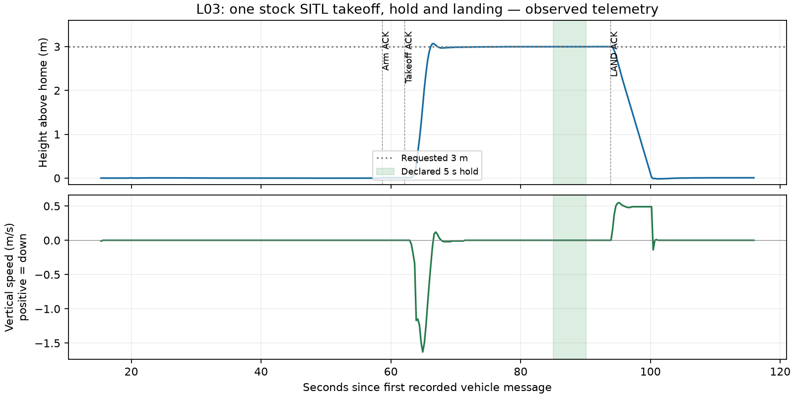

# L03 — One stock simulated takeoff, hold and landing

**Retention update — 2026-11-02:** generated CSV/TXT exports were removed at the user’s request. References below describe the original export provenance; retained summaries/figures and source/recording identities remain. See the [retention note](../README.md).

[Project](../../../README.md) · [Learning card](../../phases/learning/l03-first-stock-flight.md) · [L02 setup/runbook](../l02-basic-sitl-setup/README.md)

Executed locally on 2026-10-31, approximately 17:27–17:29 America/Toronto (21:27–21:29 UTC). The user requested publication of L02 followed by “CO3 in new track”; the new-chat handoff explicitly identifies that next phase as L03. Work is local on `codex/l03-first-stock-flight`, created from published L02 commit `7a2c6652dbd8088b66d8d9c2cb123c0bc52a78ee`. The simulator exercise itself made no commit, push or merge. After the guided checkpoint, the user authorized saving and pushing the L03 records before moving to the next phase; publication scope is recorded below.

**Observed result:** unchanged stock Copter took off to 3 m, held near that height, landed and automatically disarmed. The flight exercise and guided learner explanation checkpoint are complete, so L03 is `complete`. P01 remains in progress. L04 has not started.

## Concept and prediction

A command requests an action. An acknowledgment reports whether ArduPilot accepted that request. Measured state establishes what subsequently happened. Before flight, the learner was told to expect a 3 m climb, a five-second hold, descent, on-ground detection and automatic motor disarming. Each flight action was explained before execution.

`GUIDED` lets stock ArduPilot perform the requested movement with its own controllers. `arm throttle` enables motors after normal checks; it does not mean takeoff. `takeoff 3` requests 3 m relative to home, established at the starting ground in this flat built-in scene. No terrain-relative navigation is qualified. `mode land` requests the stock landing mode. No custom flight code or external authoritative flight state machine was added.

The five-second observation was declared after the climb settled: height 2.8–3.2 m, absolute vertical speed at most 0.2 m/s, horizontal speed at most 0.3 m/s, armed GUIDED and IN_AIR. This is a simple manual observation, not a reliability campaign. Total hover time also includes the explanations and manual observations; five seconds was the measured hold window, not the entire airborne duration.

## Environment and launch

Reused the L02 environment and executable without rebuilding or reinstalling: macOS 15.7.7 arm64, Python 3.12.12, MAVProxy 1.8.75, pymavlink 2.4.50 and unchanged `Copter-4.7.2` at `fb773567896014da007bca58358704d4a0d8516f`. See the [L02 environment](../l02-basic-sitl-setup/environment.json) and [frozen dependencies](../l02-basic-sitl-setup/requirements.lock.txt). The firmware checkout and all 21 recursive submodule pins were preserved. No system/shell/credential changes were made. The navigation guide was checked and remains absent.

One instance, one command source (MAVProxy). Before launch, no matching simulator endpoints were found; both MAVProxy startup-script locations were absent. An auxiliary pymavlink receiver recorded the forwarded UDP stream and sent **no messages**. Its local script and raw JSONL remain under `.local/l03/`; these are manual recording artifacts, not automated tests or reusable flight tooling.

Exact launch from the project root (use a new empty run directory for any later reproduction):

```sh
l03_root="$PWD"
l03_run_dir="$l03_root/.local/l03/run1"
mkdir -p "$l03_run_dir"
env -u DISPLAY SITL_RITW_TERMINAL=bash TMPDIR="$l03_run_dir/" \
  PATH="$l03_root/.local/l02/venv/bin:/usr/bin:/bin:/usr/sbin:/sbin" \
  /usr/bin/script -q "$l03_run_dir/console.log" \
  "$l03_root/.local/l02/venv/bin/python" \
  "$l03_root/ardupilot/Tools/autotest/sim_vehicle.py" \
  -v ArduCopter -f quad -N --use-dir "$l03_run_dir" \
  --no-extra-ports --out 127.0.0.1:14550 \
  --mavproxy-args=--default-modules=log,param,mode,arm,rc,cmdlong,output
```

The existing `cmdlong` module provides `takeoff` and `long`; no additional module was needed. The `quad` profile resolves to the stock `+` model and `copter.parm`, at speedup 1. The saved selected parameters (generated export removed) include `ARMING_SKIPCHK=0`, `ARMING_OPTIONS=0`, `LAND_SPD_MS=0.5` and `FS_GCS_ENABLE=0`. No parameter-write or forced-arm command was issued. Stock configuration is recorded as observed, not presented as a hardware or link-loss safety profile.

Console command sequence, with observation/wait boundaries retained in the transcript (generated export removed):

```text
long SET_MESSAGE_INTERVAL 245 500000
status GPS_RAW_INT
status EKF_STATUS_REPORT
status SYS_STATUS
status HEARTBEAT
arm list
set streamrate 4
long SET_MESSAGE_INTERVAL 33 250000
long SET_MESSAGE_INTERVAL 32 250000
status
arm prearms
# Early result: PreArm: Gyros inconsistent. Remained disarmed; waited.
arm prearms
status SYS_STATUS
status EKF_STATUS_REPORT
status GLOBAL_POSITION_INT
status EXTENDED_SYS_STATE
mode guided
# Confirmed GUIDED, still disarmed/on ground.
arm throttle
# Confirmed accepted + armed, then promptly sent:
takeoff 3
# Observed climb and IN_AIR; then observed the declared 5-second hold.
mode land
# Waited for descent, ON_GROUND and automatic disarm.
status HEARTBEAT
status GLOBAL_POSITION_INT
status EXTENDED_SYS_STATE
status COMMAND_ACK
```

The message requests select landed-state ID 245 every 500,000 microseconds (2 Hz), global-position ID 33 and local-position ID 32 every 250,000 microseconds (4 Hz). All three requests were accepted and the messages were actually received. `set streamrate 4` restates MAVProxy's default rate; these telemetry requests do not change flight behavior. Arming and takeoff acknowledgments were about 3.50 seconds apart, within the stock pre-takeoff auto-disarm interval.

## What happened

Times below are received-message times relative to the first recorded vehicle message, 21:26:59.618 UTC. They are sampled observations, not exact physical transition instants.

| Time (s) | Request or observation | Meaning |
| --- | --- | --- |
| 6.829 | Landed-state stream request accepted; ON_GROUND followed | Explicit landed-state evidence became available. |
| 21.258 | Prearm-check request accepted, followed by “Gyros inconsistent” | Request accepted does not mean checks passed. Stayed disarmed. |
| 46.965 | Repeated prearm-check request accepted, without a new failure | Both EKF3 IMUs had reported using GPS; health flags recovered. |
| 52.871 | GUIDED acknowledgment and mode heartbeat | Mode changed while disarmed and on ground. |
| 58.620 / 58.838 | Normal arm accepted / first armed heartbeat | Motors enabled; no force/bypass. |
| 62.122 | Takeoff acknowledgment accepted | Request to rise to 3 m accepted; not arrival evidence. |
| 63.345 / 66.347 | TAKEOFF / IN_AIR reports | Flight-state progression accompanied the measured climb. |
| 85.054–90.054 | Declared five-second hold observation | 20 position samples at 2.999 m; 5 armed GUIDED heartbeats and 10 IN_AIR reports. |
| 93.830 / 93.849 | LAND accepted and reported / LANDING state | Descent followed; measured downward speed approached 0.5 m/s. |
| 100.204 | Simulator reported ground contact at 0.496654 m/s | Privileged simulator corroboration, separate from estimator/land-detector state. |
| 101.852 / 102.847 | ON_GROUND / first disarmed heartbeat | Landing and motor shutdown confirmed before process termination. |

Maximum estimated height was **3.069 m** during the climb/settling. In the declared hold, reported vertical speed was 0.00 m/s at the message's centimetre-per-second resolution; maximum horizontal speed was 0.0142 m/s. The 20 position samples span 4.747 seconds inside the five-second wall-clock window; this does not imply continuous measurement between samples. Final saved observations show height 0.007 m, vertical speed 0.00 m/s, ON_GROUND and disarmed LAND. Small millimetre offsets near ground are estimator output, not evidence that the vehicle remained airborne.



Trajectory CSV (generated export removed) retains every received global-position sample with latest mode/arming/landed state and their ages. [Command/state events](command-state-events.json) retain all acknowledgments, status text and mode/arming/landed transitions from vehicle source `1:1`; console source `255:230` is separate. [Run results](run-results.json) include counts and hold metrics. There were 120 vehicle heartbeats, 45 armed heartbeats and nine accepted command acknowledgments. No flight-command rejection occurred; the early readiness failure is preserved rather than relabeled as success.

The [onboard log summary](onboard-log-summary.json) separately parses the actual stock DataFlash log. `MAVC` records show normal arm with parameter 2 equal to zero, takeoff in relative-altitude frame 3 with altitude 3 m, and LAND mode 9, all accepted. The terminal ARM record reports disarmed and `Forced=0`; no ERR records were parsed. This is corroboration within the same simulated system, not independent verification. Logging starts around arming (`LOG_DISARMED=0`); telemetry/console retain earlier startup and the unready check.

## Limitations and retained raw evidence

Four MAVProxy parsing errors were reported during startup, as in L02. Their cause was not investigated. Observed vehicle communication/error counters were zero; that does not erase the console errors. Terrain requests remained pending with zero loaded; no terrain-navigation capability is qualified. No stock failsafes or prearm checks were bypassed, and no failure injection was performed. In particular the stock ground-link failsafe is disabled; this flight does not qualify lost-link handling.

This is one clear-scene simulated flight, not repeatability, obstacle avoidance, object perception, a coordinate mission, custom firmware or hardware qualification. No Gazebo, ROS, product UI, snapshots, automated tests or test scaffolding were added. The separate SkyDive and FeatherLaneFlight projects were untouched. Estimator state comes from simulated sensors; SIM/SIM2/SIMSTATE truth was not supplied as a new autonomy input.

The [raw-artifact manifest](raw-artifacts.json) records exact paths, sizes and SHA-256 hashes for the ignored local console, MAVLink logs, passive capture, EEPROM, parameters, onboard `logs/00000001.BIN`, hold-window declaration, process/session records and cleanup evidence. These raw logs are retained under `.local/l03/run1/` and are not part of the curated Git record. The full flight log is locally retained, not merely reconstructed from summaries.

## Stop, rollback and documentation

After confirming fresh ON_GROUND and disarmed telemetry, matched owned PID `65466`, the exact executable and `SIM_VEHICLE_SESSION=611348577af11961`, then sent SIGTERM to that simulator only. Ctrl-C closed MAVProxy/launcher using its stock session-scoped cleanup. Brief EOF/reconnect/connection-refused output followed deliberate simulator shutdown; it is not a crash finding. The passive observer was deliberately interrupted afterward (exit 130 with a KeyboardInterrupt traceback); it flushed each JSONL record before stopping. Final checks found no session-owned processes and no listeners on TCP 5760/5762/5763 or UDP 5501/14550. No broad process kill was used.

Stock listeners had wildcard binds, as in L02; this is not a localhost-only isolation claim. No firewall or remote resource was changed.

Rollback: the executable/source/dependency baseline is unchanged. No flight parameter restoration is needed. Retain the evidence, stop only owned tooling, and use a fresh empty run directory for a later authorized session. Do not reuse this run's EEPROM accidentally or update upstream/submodules. Do not confuse stopping a future airborne process with performing a landing.

Maintained status comes from the registry; cards/master are generated by `scripts/render-learning-plan.py`. The existing learning-progress diagram is updated through installed Archify validation, delivery, strict artifact and browser checks, with receipts/viewers ignored. The core architecture is unchanged and UI/architecture approval flags remain false. See [execution summary](execution-summary.json) for the actual final checks. No new design approval is inferred.

## Publication scope

On 2026-10-31, after the learner confirmed understanding of the launcher, MAVProxy and telemetry flow, the user asked: “Should we push them and then moving on to the next phase?” This authorizes committing/pushing the maintained L03 documents, static learning diagram/source and selected flight evidence on `codex/l03-first-stock-flight`. The unchanged firmware gitlink is preserved; this scope does not include merging/updating `main` or publishing L04 work. The frozen Python dependency audit completed before commit: 29 dependencies checked, no known vulnerabilities found. Audit warnings about absent requirement hashes and raw output remain under `.local/l03/`. Raw runs, the Python environment, local capture/processing helpers, generated HTML and validation receipts remain ignored. Actual commit/remote-SHA verification is retained locally in `.local/l03/publication.json`.

## Learning checkpoint

Asked in this chat after the observed flight: **What proved takeoff actually happened beyond the console saying the command was accepted?** The learner answered in this chat on 2026-10-31, identifying the hold near three metres, vertical speed and takeoff/landing evidence “by the observed telemetry.” The guided follow-up connected rising height and climb speed to takeoff, near-zero speed at height to holding, and falling height plus ON_GROUND/automatic disarming to landing. After the earlier SITL explanation, this completes the guided L03 checkpoint; it is not an independent examination or independent verification of flight. L04 is the proposed next learning phase; it was not started.

## Sources checked before flight

- [Official Copter SITL/MAVProxy tutorial](https://ardupilot.org/dev/docs/copter-sitl-mavproxy-tutorial.html): GUIDED, normal arming and takeoff sequence.
- [Official GUIDED documentation](https://ardupilot.org/copter/docs/ac2_guidedmode.html) and [LAND documentation](https://ardupilot.org/copter/docs/land-mode.html). Current web parameter names were checked against the pinned source and actual saved parameters.
- [MAVLink EXTENDED_SYS_STATE](https://mavlink.io/en/messages/common.html#EXTENDED_SYS_STATE): landed-state semantics.
- Installed MAVProxy `mavproxy_cmdlong.py`, `mavproxy_mode.py`, `mavproxy_arm.py`; pinned `ArduCopter/GCS_MAVLink_Copter.cpp` takeoff/frame conversion and landed-state implementation, and `libraries/GCS_MAVLink/GCS_Common.cpp` extended-state sender. These actual implementations, not assumed tutorial compatibility, were inspected before commands.
