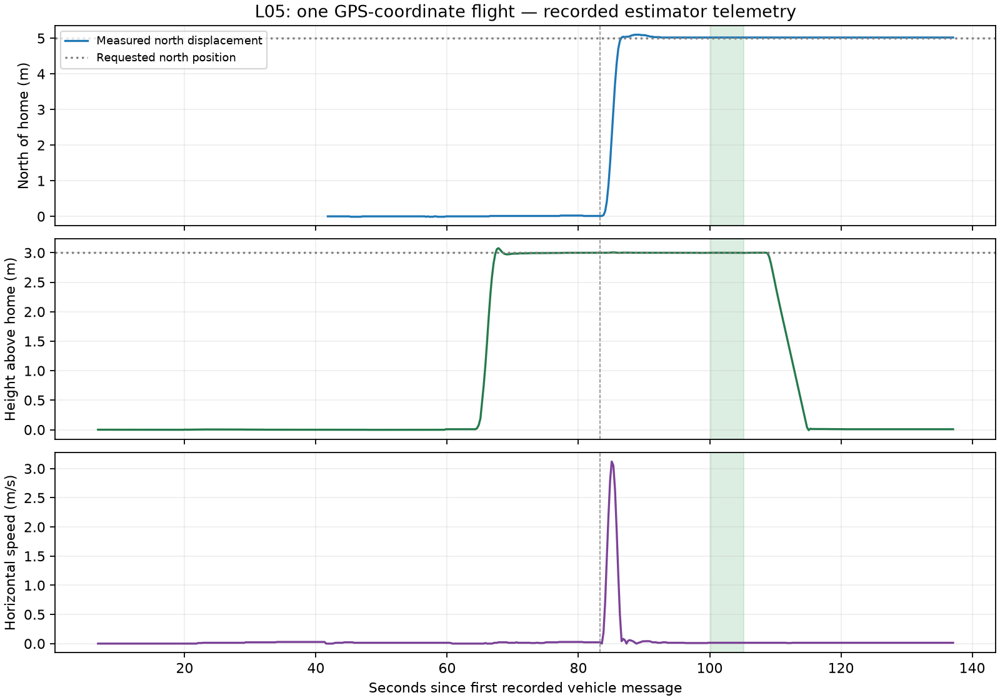

# L05 — One known GPS-coordinate flight

**Retention update — 2026-11-02:** generated CSV/TXT exports were removed at the user’s request. References below describe the original export provenance; retained summaries/figures and source/recording identities remain. See the [retention note](../README.md).

[Project](../../../README.md) · [Learning card](../../phases/learning/l05-one-coordinate.md) · [L03 flight baseline](../l03-first-stock-flight/README.md) · [L04 source walkthrough](../l04-trace-one-command/README.md)

Executed locally on 2026-10-31, approximately 18:11–18:13 America/Toronto (22:11–22:13 UTC), after the user explicitly requested pushing completed L04 and starting L05. L04 was committed/pushed as `c0f6254470fea3c4c22d4de43cfae0df21cef07d`; its remote branch was compared with the local SHA, and `main` remained `c45c9e19ae279011d5779fa2669df3fac0f21a29`. L05 runs on local branch `codex/l05-one-coordinate`, created from that published L04 commit. The flight exercise itself made no commit, push or merge. The user subsequently authorized publishing this completed L05 record before starting L06.

**L05 is complete:** one stock GUIDED coordinate request was accepted, the intended location was reached and held, then LAND/on-ground/automatic disarm and owned-session cleanup were observed. The guided learner checkpoint is complete. L06 has not started. This is one bounded stock-coordinate slice contributing to P03; its broader gate is not complete. P01’s remaining failed/rejected-connection handling is still open.

## What we predicted and declared

A destination needs a coordinate frame, units and a reference for height. Before launch, the declared goal was latitude **-35.3632172°**, longitude **149.1652374°**, altitude **3 m above home**, approximately **5 m north** of the normal starting point in the same clear built-in scene. Keep stock speed settings. Take off to 3 m as in L03, send one destination through the existing MAVProxy console, observe the resulting position/speed, then land at that location. No detector, custom flight code or authoritative external mission runtime is involved.

[Pre-run goal declaration](goal-declaration.json) records the command frame, goal, prediction and limits. The manual terminal observation was declared before flight: horizontal error ≤1 m, height 2.8–3.2 m above home, horizontal speed ≤0.3 m/s, absolute vertical speed ≤0.2 m/s, armed GUIDED/IN_AIR, observed for five seconds after settling. If rejected or not settled within 30 s, retain that result and use the already qualified stock LAND path without bypass. This is a manual observation of one flight, not the generalized stopping/arrival work reserved for L07.

## Meaning of the numbers

| Item | Actual meaning |
| --- | --- |
| Latitude/longitude | Global Earth-referenced coordinates in decimal degrees; latitude increases toward north. Here a less-negative latitude is northward. They are not metres or a body-heading-relative offset. |
| Wire coordinates | COMMAND_INT stores degrees ×10^7: X=-353632172, Y=1491652374. |
| Altitude 3 | Metres above the recorded home point, frame 3 (`MAV_FRAME_GLOBAL_RELATIVE_ALT`), not 3 m above sea level or terrain. |
| Home after arming | Latitude -35.3632621°, longitude 149.1652375°, altitude 584.080 m AMSL. Thus 3 m above home is approximately 587.080 m AMSL here. |
| Estimator origin | Latitude -35.3632621°, longitude 149.1652374°, altitude 584.090 m AMSL. This separately recorded reference is used for internal local coordinates. |
| Actual requested offset from recorded home | Approximately 4.998 m north and 0.009 m west. The tiny east/reference difference reflects the home estimate recorded at arming. |
| Internal NED | North/East/Down coordinates in metres relative to the estimator origin; up is negative Down. ArduPilot converts the admitted global destination to this internal representation. |

Home and estimator origin initially matched, then the home estimate updated slightly at arming. Both records are retained rather than assumed identical. The same numeric local coordinate with another origin refers to another place; the same numeric height with another altitude frame refers to another height. Changing our global latitude/longitude does not mean moving a fixed distance forward relative to the drone’s heading.

## Commands and entry points

Reused the existing L02 virtual environment and unchanged built executable: macOS 15.7.7 arm64, Python 3.12.12, MAVProxy 1.8.75, pymavlink 2.4.50 and Copter-4.7.2 at `fb773567896014da007bca58358704d4a0d8516f`. No build, install, upstream/submodule update, shell profile or system Python change. The navigation guide was checked and remains absent. Both MAVProxy startup-script locations were absent; no other matching simulator/controller or occupied endpoints were found before launch.

The experiment was explained before each flight action. As in L03, our local `capture.py` was started first and sent no MAVLink messages:

```sh
.local/l02/venv/bin/python .local/l05/capture.py
```

It listens to `udpin:127.0.0.1:14550` and flushes messages into `.local/l05/run1/observations.jsonl`. Then the exact launcher command, from the project root, was:

```sh
l05_root="$PWD"
l05_run_dir="$l05_root/.local/l05/run1"
env -u DISPLAY SITL_RITW_TERMINAL=bash TMPDIR="$l05_run_dir/"   PATH="$l05_root/.local/l02/venv/bin:/usr/bin:/bin:/usr/sbin:/sbin"   /usr/bin/script -q "$l05_run_dir/console.log"   "$l05_root/.local/l02/venv/bin/python"   "$l05_root/ardupilot/Tools/autotest/sim_vehicle.py"   -v ArduCopter -f quad -N --use-dir "$l05_run_dir"   --no-extra-ports --out 127.0.0.1:14550   --mavproxy-args=--default-modules=log,param,mode,arm,rc,cmdlong,output
```

The console was the sole command source. Main commands, interspersed with the waits/observations in the transcript (generated export removed):

```text
long SET_MESSAGE_INTERVAL 245 500000
long SET_MESSAGE_INTERVAL 33 250000
long SET_MESSAGE_INTERVAL 32 250000
set guided_use_reposition true
set flytoframe AboveHome
set height_unit m
set guided_use_reposition
set flytoframe
set height_unit
arm prearms
status GPS_RAW_INT
status EKF_STATUS_REPORT
status SYS_STATUS
status GLOBAL_POSITION_INT
status EXTENDED_SYS_STATE
long REQUEST_MESSAGE HOME_POSITION
long REQUEST_MESSAGE GPS_GLOBAL_ORIGIN
# Waited for both EKF3 IMUs to report using GPS.
arm prearms
long REQUEST_MESSAGE HOME_POSITION
long REQUEST_MESSAGE GPS_GLOBAL_ORIGIN
status HEARTBEAT
mode guided
# Confirmed mode; then normal arm, confirmed armed, and takeoff promptly:
arm throttle
takeoff 3
# Observed settled height and IN_AIR before sending this one destination:
guided -35.3632172 149.1652374 3
# Observed movement, then the declared five-second terminal window.
mode land
# Waited for ON_GROUND and automatic disarm.
long REQUEST_MESSAGE HOME_POSITION
long REQUEST_MESSAGE GPS_GLOBAL_ORIGIN
status
```

The three `set` commands restate installed MAVProxy defaults and were queried back as True/AboveHome/m. They are console settings, not firmware parameter writes. Selected stock parameters (generated export removed) retain `GUID_OPTIONS=0`, `ARMING_SKIPCHK=0`, `WP_SPD=10`, `WP_ACC=2.5`, `WP_SPD_UP=2.5`, `LAND_SPD_MS=0.5` and `FS_GCS_ENABLE=0`. None was changed; the speed parameter is a limit, not a claim that this short flight reached 10 m/s. No forced arming or failsafe/prearm bypass occurred.

## Destination acceptance in the pinned source

Installed MAVProxy `mavproxy_mode.py::cmd_guided` parses the three numbers, uses the selected AboveHome/metre settings and sends COMMAND_INT `MAV_CMD_DO_REPOSITION` (192). Parameter 1=-1 retains default speed; parameter 2=1 allows GUIDED mode selection; the vehicle was already in GUIDED. Source was inspected before the flight. This is not an uploaded mission or a repeated velocity/setpoint stream.

- [Copter reposition receiver](https://github.com/ArduPilot/ardupilot/blob/fb773567896014da007bca58358704d4a0d8516f/ArduCopter/GCS_MAVLink_Copter.cpp#L457) checks GUIDED/change-mode policy, latitude/longitude, coordinate frame and location validity, then attempts to set the destination. Rejection propagates as a failed/denied command result; successful admission returns ACCEPTED.
- [Location/frame conversion](https://github.com/ArduPilot/ardupilot/blob/fb773567896014da007bca58358704d4a0d8516f/libraries/GCS_MAVLink/GCS_Common.cpp#L5269) copies integer latitude/longitude and converts the height using the supplied altitude frame.
- [GUIDED destination](https://github.com/ArduPilot/ardupilot/blob/fb773567896014da007bca58358704d4a0d8516f/ArduCopter/mode_guided.cpp#L466) checks the configured fence when enabled, converts the location, selects the stock position submode for the default GUID_OPTIONS=0 path, stores the target and zeroes target velocity/acceleration.
- [Conversion to local NED](https://github.com/ArduPilot/ardupilot/blob/fb773567896014da007bca58358704d4a0d8516f/libraries/AC_WPNav/AC_WPNav.cpp#L981) converts latitude/longitude relative to the estimator origin and converts the height to altitude above that origin, then changes its sign for Down.
- [GUIDED position control](https://github.com/ArduPilot/ardupilot/blob/fb773567896014da007bca58358704d4a0d8516f/ArduCopter/mode_guided.cpp#L735) feeds the stored target to the position controllers and then supplies thrust direction/heading to attitude control. It continues holding after the single destination request.

[Source manifest](source-manifest.json) retains exact symbols, lines, hashes and immutable upstream links. The actual onboard `MAVC` record from this same simulator separately records Cmd=192, frame=3, X=-353632172, Y=1491652374, Z=3, result=0, WL=0 (COMMAND_INT). This corroborates the inspected ingress path; it is not an independent external verification or instruction-level runtime trace.

## Actual movement and terminal state

Times are received-message times relative to 22:11:12.319 UTC, not exact physical transition instants.

| Time (s) | Actual observation |
| --- | --- |
| 58.570 / 59.683 | GUIDED accepted / normal arm accepted. First armed heartbeat at 59.836. |
| 63.384 | Takeoff to 3 m accepted. TAKEOFF/IN_AIR reports followed at 64.816/67.815. |
| 83.319 | Single coordinate request accepted. Measured northward motion followed. |
| 86.577 | First recorded sample within the declared position/height/speed bounds, 3.258 s after acceptance. This alone is not a dwell guarantee. |
| 100.172–105.172 | Declared five-second terminal window: 20 position samples with horizontal error 0.0240 m, height 2.997–3.000 m, maximum horizontal speed 0.0142 m/s and reported vertical speed 0.00 m/s. All sampled bounds passed. |
| 108.523 | LAND mode request accepted. Descent followed at the destination. |
| 114.889 | Simulator reported ground contact at 0.497646 m/s, kept separate from estimator/land-detector evidence. |
| 116.831 / 117.855 | ON_GROUND / first disarmed heartbeat, before any process termination. |

There were 522 global-position samples, 141 vehicle heartbeats and 16 accepted command acknowledgments. Peak measured horizontal speed after the destination request was about 3.120 m/s. The hold started 16.852 s after destination acceptance, within the declared 30-second limit; its 20 samples span 4.749 s inside the five-second observation window. Final estimated height was 0.008 m above home with zero reported vertical speed, disarmed LAND and ON_GROUND. Small near-zero height offsets are estimator output, not an airborne-state claim.



This image was generated after flight by our local `.local/l05/curate.py` using Python/Matplotlib from the captured messages. `sim_vehicle.py` is the flight-session entry point; the processing script is only an offline recorder/graph-support artifact. Trajectory CSV (generated export removed) retains raw latitude/longitude, validity, GPS/EKF flags, derived north/east/error, height/speed and sampled state ages. [Run results](run-results.json), [events](command-state-events.json), [onboard summary](onboard-log-summary.json) and [raw-artifact manifest](raw-artifacts.json) retain the actual results, command/state transitions and raw-log hashes/locations. Full telemetry and DataFlash log remain ignored locally under `.local/l05/run1/`.

## Invalid startup state and limitations

The recorder retained 140 early global-position samples before a qualified absolute position was available, including placeholder coordinates (0,0). An initial plotting attempt treated those as positions and produced an obviously invalid displacement scale; image review caught this. The processing was corrected to retain raw coordinates, mark validity and leave derived distance/displacement blank for invalid samples. The final plot was regenerated and inspected. Nothing was replaced with fabricated state.

The offline position-validity rule requires a GPS fix of at least 3, EKF horizontal-absolute-position flag 16 and non-placeholder latitude/longitude, using the latest captured GPS/EKF state. This is an explicit experiment filter, not a general navigation admission implementation. Flight was started only after both EKF3 IMUs reported using GPS and actual readiness was observed. No prearm failure or command rejection was reported in this L05 run.

The approximately 2.4 cm derived hold error is agreement between the requested coordinate and simulated estimator telemetry, not proof of centimetre-accurate physical GPS. Metric conversion uses a small-distance north/east projection with R=6378137 m and east scaled by cos(reference latitude). Fields have finite sampling/resolution and state messages are not exactly simultaneous. Four startup MAVProxy parsing errors were reported, their cause still uninvestigated; observed vehicle communication/error counters were zero. Terrain remained pending/zero loaded. The stock GCS-link failsafe is disabled, so no lost-link handling is qualified. No repeatability, obstacle avoidance, detector, custom firmware, GPS-denied behavior or physical operation is claimed.

No new automated tests, snapshots, test scaffolding, Gazebo, ROS or application UI were added. No speed tuning was done; L06 remains separate. Raw simulated truth messages were recorded alongside other telemetry but were not introduced as a new control input or used to score the reported coordinate error. SkyDive and FeatherLaneFlight remain untouched.

## Cleanup, rollback and checks

After fresh ON_GROUND/disarmed observations, matched owned simulator PID 96012, executable and `SIM_VEHICLE_SESSION=cbb7b2993bd2b336`, then sent SIGTERM only to that process. Ctrl-C closed MAVProxy/launcher using stock session cleanup. Brief reconnect/connection-refused output followed deliberate termination, not a crash finding. The passive recorder was intentionally interrupted afterward (exit 130 with KeyboardInterrupt; each JSONL record had been flushed). No session processes or TCP5760/5762/5763/UDP5501/14550 sockets remained. Listeners had the stock wildcard binds; no localhost-only isolation claim or firewall change is made.

Rollback: no firmware parameters or mission were changed to restore. Keep the pinned executable/source/dependencies and raw evidence; use a fresh empty directory for a later authorized session. Retain the published L04 baseline. No broad process kill, upstream update or remote-resource change occurred during L05. [Execution summary](execution-summary.json) records actual final documentation/source checks and diagram receipts. Learning documents are regenerated from the registry; only the existing progress diagram changes. Core architecture and UI/architecture approval flags remain unchanged.

## Guided learner checkpoint

Completed in this chat on 2026-10-31. Asked what the “3 metres” was measured from and whether changing the reference to sea level would keep the same height, the learner identified three metres above home. Guided clarification explained the sea-level difference using the actual recorded home altitude: 3 m above home is approximately 587.08 m AMSL; the number 3 with an AMSL reference would denote a completely different height. This is guided understanding, not an independent examination.

## Sources checked before execution

- [Official Copter SITL/MAVProxy tutorial](https://ardupilot.org/dev/docs/copter-sitl-mavproxy-tutorial.html).
- [Official GUIDED command documentation](https://ardupilot.org/dev/docs/copter-commands-in-guided-mode.html), including COMMAND_INT DO_REPOSITION.
- Installed MAVProxy 1.8.75 `mavproxy_mode.py`, `mp_module.py` frame/unit mapping and default console settings; actual pinned C++ acceptance/conversion paths above. No assumed compatibility was substituted for the inspected implementations.

## Starting-location clarification and publication

The starting simulated location came from `SIM_OPOS_LAT`, `SIM_OPOS_LNG`, `SIM_OPOS_ALT` and `SIM_OPOS_HDG`. The launch supplied no custom location. `SIM_Aircraft.cpp::update_home` initializes the model from these settings; simulated sensors/estimation then produce telemetry. The saved parameter file rounds the floating values; the telemetry provides its observed integer-coordinate values. This starting reference is separate from the later `guided` destination. The source manifest includes the parameter definitions and initializer.

On 2026-10-31, after the guided checkpoint and starting-location explanation, the user requested pushing L05 and continuing to the next phase. This authorizes committing/pushing the completed L05 documentation, progress diagram/source and selected evidence on `codex/l05-one-coordinate`, then the scoped L06 local speed comparison. No main merge/update or L06 publication is included. The pre-commit audit of frozen Python dependencies found no known vulnerabilities; warnings about absent requirement hashes and raw audit output remain under `.local/l05/`. Actual commit/remote-SHA verification is retained in `.local/l05/publication.json`. Local helpers, dependencies, raw logs and temporary HTML/receipts stay ignored.
