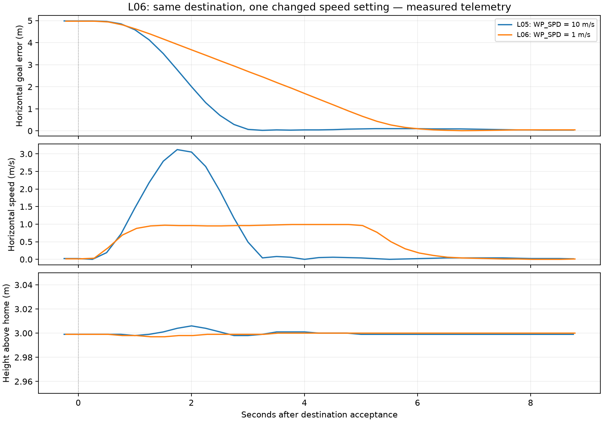

# L06 — Change one speed setting on the same route

[Project](../../../README.md) · [Learning card](../../phases/learning/l06-one-speed-change.md) · [L05 baseline](../l05-one-coordinate/README.md)

Executed locally on 2026-10-31, approximately 18:25–18:28 America/Toronto (22:25–22:28 UTC). The user explicitly requested pushing completed L05 and continuing to the next phase. L05 was published as `9dd52dc050401887de4b4d352d26b368c2a54251`, with remote SHA independently compared against local Git and `main` unchanged at `c45c9e19ae279011d5779fa2669df3fac0f21a29`. L06 was prepared locally on `codex/l06-one-speed-change`, branched from that L05 commit. The user subsequently gave separate L06 publication approval after its guided checkpoint.

**Flight exercise and guided learner checkpoint complete.** One fresh stock GUIDED run repeated the same destination/height with only the intentional speed-setting change `WP_SPD: 10 → 1 m/s`, then landed/disarmed. `WP_SPD` was restored to 10, fetched back and saved in the console’s parameter snapshot before owned-process shutdown. Automatic stock learning/statistics updates are recorded below. L06 is complete. L07 has not started. P01 and P03 remain incomplete.

## Concept and prediction before the change

A speed setting constrains requested motion; it is not a promise that measured speed will be constant from start to stop. Acceleration, braking, feedback and the length of the route still matter. L05’s short route peaked at about 3.12 m/s, below its original 10 m/s setting. Predict a lower peak near 1 m/s and a longer trip when that setting is reduced to 1 m/s, while keeping the route, height, acceleration and controller settings fixed.

[Pre-run declaration](goal-declaration.json) retains that prediction and the same goal: latitude -35.3632172°, longitude 149.1652374°, 3 m above home; frame 3, GLOBAL_RELATIVE_ALT. The nominal simulator start/model/source, speedup=1, MAVProxy path and scene match L05. Home/estimator-origin observations remain recorded separately, including their small estimate differences. This is one baseline/repeat pair, not a statistical campaign.

The same terminal observation bounds were used: horizontal error ≤1 m, height 2.8–3.2 m above home, horizontal speed ≤0.3 m/s, absolute vertical speed ≤0.2 m/s, armed GUIDED/IN_AIR, observed for five seconds. The predeclared settling wait limit remained 30 seconds. No controller or acceleration tuning, route change, detector or custom mission runtime was added.

## Exact changed parameter, units and persistence

`WP_SPD` is metres per second in this pinned Copter-4.7.2 source, not centimetres per second. The initial fetched value was 10.0 and `WP_ACC` was 2.5 m/s². The installed stock GUIDED path with `GUID_OPTIONS=0` starts its position controller using this parameter through `get_default_speed_NE_ms()`. We changed the parameter while disarmed, before GUIDED/destination initialization. No reboot was needed for that selected path.

A MAVProxy `param set` sends a MAVLink parameter write. ArduPilot sets and saves the value in the run’s EEPROM-backed parameter store, then returns parameter data; this is different from a flight COMMAND_ACK. We used `param fetch`/`param show` and full cached parameter snapshots to confirm values. Reusing this run directory would retain saved configuration; a new empty directory isolates a later stock run. Source evidence below establishes the save path; no restart was performed to independently re-read EEPROM after restoration.

## Launch, command sequence and recording

Reused the L02 environment and executable without rebuilding/reinstalling: macOS 15.7.7 arm64, Python 3.12.12, MAVProxy 1.8.75, pymavlink 2.4.50, unchanged Copter at `fb773567896014da007bca58358704d4a0d8516f` and all 21 recursive submodule pins. No other controller/process/socket or MAVProxy startup script was found before launch. No system Python, user profile, credentials, remote resources or unrelated checkout was changed.

Our passive local recorder was started first:

```sh
.local/l02/venv/bin/python .local/l06/capture.py
```

It receives forwarded telemetry on UDP14550 and sends no messages. Then the same launcher was used with a fresh directory:

```sh
l06_root="$PWD"
l06_run_dir="$l06_root/.local/l06/run1"
env -u DISPLAY SITL_RITW_TERMINAL=bash TMPDIR="$l06_run_dir/"   PATH="$l06_root/.local/l02/venv/bin:/usr/bin:/bin:/usr/sbin:/sbin"   /usr/bin/script -q "$l06_run_dir/console.log"   "$l06_root/.local/l02/venv/bin/python"   "$l06_root/ardupilot/Tools/autotest/sim_vehicle.py"   -v ArduCopter -f quad -N --use-dir "$l06_run_dir"   --no-extra-ports --out 127.0.0.1:14550   --mavproxy-args=--default-modules=log,param,mode,arm,rc,cmdlong,output
```

Each flight action was explained before execution. Main console commands, with the waits/readbacks in the [transcript](console.txt):

```text
long SET_MESSAGE_INTERVAL 245 500000
long SET_MESSAGE_INTERVAL 33 250000
long SET_MESSAGE_INTERVAL 32 250000
set guided_use_reposition true
set flytoframe AboveHome
set height_unit m
# Waited for simulated GPS and both EKF3 IMUs using GPS.
arm prearms
status GPS_RAW_INT
status EKF_STATUS_REPORT
status SYS_STATUS
status EXTENDED_SYS_STATE
long REQUEST_MESSAGE HOME_POSITION
long REQUEST_MESSAGE GPS_GLOBAL_ORIGIN
param show WP_SPD
param show WP_ACC
param save params-before.parm
param set WP_SPD 1
param fetch WP_SPD
param show WP_SPD
param save params-during.parm
mode guided
arm throttle
# Confirmed normal armed state, then promptly:
takeoff 3
# Observed settled 3m height/IN_AIR, then the identical destination:
guided -35.3632172 149.1652374 3
# Observed movement and a five-second terminal hold.
mode land
# Waited for ON_GROUND and automatic disarm before restoring:
param set WP_SPD 10
param fetch WP_SPD
param show WP_SPD
param save params-restored.parm
long REQUEST_MESSAGE HOME_POSITION
long REQUEST_MESSAGE GPS_GLOBAL_ORIGIN
status
```

All console frame/unit `set` commands restated the same defaults used in L05. The DO_REPOSITION request retained parameter1=-1 (use default speed) and the identical integer latitude/longitude/height/frame. `WP_SPD` was therefore the only deliberate flight-configuration change; it is restored. No force-arm, check bypass, failsafe disable or other parameter write was issued.

## Measured comparison

| Measurement | L05 baseline | L06 changed run |
| --- | ---: | ---: |
| Configured WP_SPD | 10 m/s | 1 m/s during flight; restored to 10 |
| Peak measured horizontal speed after destination request | 3.120 m/s | 0.990 m/s |
| First recorded sample within identical near-goal position/height/speed bounds after acceptance | 3.258 s | 5.782 s |
| Hold horizontal goal error | 0.0240 m | 0.0240–0.0287 m |
| Hold height above home | 2.997–3.000 m | 2.997–3.000 m |
| Maximum hold horizontal speed | 0.0142 m/s | 0.0224 m/s |
| Reported hold vertical speed | 0.00 m/s | 0.00 m/s |

Both five-second windows have 20 position samples and all sampled bounds pass. The changed run’s window began 13.554 s after destination acceptance, within the declared limit; its samples span 4.752 s inside that wall-clock window. These sampled metrics do not establish an exact continuous arrival instant. No claim of ten-fold travel-time change is made: the original short flight did not reach its 10 m/s setting.



The image was generated after the flight by our `.local/l06/compare.py` using Python/Matplotlib, reading both retained trajectory CSVs. Curves are aligned at each received DO_REPOSITION acceptance, not simulator launch or the operator-selected hold window. Startup invalid positions are excluded from derived distances/plots using the same explicit validity rule as L05; raw coordinates and validity flags remain in [trajectory.csv](trajectory.csv). The [full changed-run chart](coordinate-flight-trajectory.png) separately shows takeoff and landing. [Comparison JSON](comparison.json) preserves metrics, goal equality, recorded home/reference differences and interpretation limits.

L06 had 612 global-position samples (131 retained startup-invalid samples), 166 vehicle heartbeats and 13 accepted command acknowledgments. No prearm failure or command rejection was reported. The onboard MAVC records corroborate normal arming, takeoff, the identical COMMAND_INT reposition and LAND; automatic disarm followed. Times from the first recorded vehicle message at 22:25:02.779 UTC: GUIDED accepted 60.708 s, arm 61.810 s, takeoff 65.417 s, coordinate 90.394 s, LAND 108.990 s, ON_GROUND 117.431 s and first disarmed heartbeat 117.851 s. Final saved position showed height 0.008 m, zero reported vertical speed, ON_GROUND and disarmed LAND. Simulator ground-contact text is retained separately from estimator/land-detector state.

## Parameter comparison and automatic updates

The full before/during cached snapshots each contained 1,370 parameters. Their only difference was `WP_SPD: 10 → 1`. After landing, the speed was fetched back as 10 and another snapshot was saved. The first strict full-list equality check after restoration did not pass; it exposed stock automatic updates, which were investigated and retained rather than reset or hidden.

| Automatically saved field | Before | After landing |
| --- | ---: | ---: |
| MOT_THST_HOVER | 0.390000 | 0.366839 |
| STAT_FLTTIME | 0 | 50 |
| STAT_DISTFLWN | 0 | 9.493561 |
| STAT_FLTCNT | 0 | 1 |
| STAT_RUNTIME | 30 | 117 |

`MOT_HOVER_LEARN=2` was unchanged: stock ArduPilot learns hover throttle and saves it on disarm. The flight/time/distance counters also update themselves. No other configuration difference remained. [Parameter comparison](parameter-comparison.json) records the intentional change/restoration separately from those automatic updates. Full raw snapshots stay under `.local/l06/run1/` and are hashed in the manifest. The [selected during-flight parameters](selected-parameters.txt) show WP_SPD=1, unchanged acceleration/controller settings and the stock profile.

The baseline’s DataFlash log also records hover learning from 0.39 to about 0.366061; L06 records 0.39 to about 0.366839. Both started with the same stock hover estimate. Their adaptive estimates and small state differences are observational limitations; this one pair is evidence consistent with the speed-setting prediction, not a perfectly isolated statistical performance proof.

## Source evidence

- [WP_SPD definition/units](https://github.com/ArduPilot/ardupilot/blob/fb773567896014da007bca58358704d4a0d8516f/libraries/AC_WPNav/AC_WPNav.cpp#L56).
- [Default-speed getter](https://github.com/ArduPilot/ardupilot/blob/fb773567896014da007bca58358704d4a0d8516f/libraries/AC_WPNav/AC_WPNav.h#L102).
- [GUIDED position-controller limits](https://github.com/ArduPilot/ardupilot/blob/fb773567896014da007bca58358704d4a0d8516f/ArduCopter/mode_guided.cpp#L252).
- [GUIDED position-submode initialization](https://github.com/ArduPilot/ardupilot/blob/fb773567896014da007bca58358704d4a0d8516f/ArduCopter/mode_guided.cpp#L274).
- [Parameter write/save handler](https://github.com/ArduPilot/ardupilot/blob/fb773567896014da007bca58358704d4a0d8516f/libraries/GCS_MAVLink/GCS_Param.cpp#L265).
- [Stock hover-learning update](https://github.com/ArduPilot/ardupilot/blob/fb773567896014da007bca58358704d4a0d8516f/ArduCopter/Attitude.cpp#L32).
- [Hover estimate save on disarm](https://github.com/ArduPilot/ardupilot/blob/fb773567896014da007bca58358704d4a0d8516f/libraries/AP_Motors/AP_MotorsMulticopter.cpp#L943).
- [Automatic statistics flush](https://github.com/ArduPilot/ardupilot/blob/fb773567896014da007bca58358704d4a0d8516f/libraries/AP_Stats/AP_Stats.cpp#L88).

[Source manifest](source-manifest.json) retains exact pinned lines and full-file hashes. Before execution, the [official GUIDED speed-control documentation](https://ardupilot.org/copter/docs/ac2_guidedmode.html#speed-control) was checked against these units and actual selected code. An attempted direct MAVProxy parameter-guide page read was unavailable; the installed parameter module and pinned C++ write/save implementation supplied the actual command/persistence evidence.

## Evidence, limitations and rollback

[Run results](run-results.json), [events including WP_SPD parameter returns](command-state-events.json), [onboard log summary](onboard-log-summary.json) and [raw-artifact manifest](raw-artifacts.json) retain command/state evidence and exact raw-file hashes/locations. Full `.tlog`, passive JSONL, DataFlash, EEPROM, parameter snapshots and local helper source remain ignored locally. Curated JSON uses null for unknown/non-finite fields; raw observations are preserved. These helpers are manual recording/offline analysis artifacts, not automated tests or a flight state machine.

Four MAVProxy startup parsing errors remain uninvestigated; observed vehicle communication/error counters were zero. No terrain data/capability, lost-link handling (`FS_GCS_ENABLE=0` unchanged), repeatability, perception, avoidance, GPS-denied behavior or hardware performance is qualified. Both runs used sensor-derived estimator telemetry for the comparison, not SIM/SIMSTATE truth as a new control/evaluation input. Position precision in simulation is not a physical GPS accuracy claim. Ground truth messages may be in raw logs but were not substituted for reported state.

After landing/disarm and the confirmed speed restoration, matched owned simulator PID 6439, exact executable and `SIM_VEHICLE_SESSION=66e194b29a35df2b`, then sent SIGTERM only to that simulator. Ctrl-C closed MAVProxy/launcher; the passive recorder was intentionally interrupted afterward (exit 130, flushed JSONL). Brief console reconnect/connection-refused output followed deliberate shutdown. No session-owned processes or TCP 5760/5762/5763 and UDP 5501/14550 sockets remained. Stock listeners had wildcard binds; no localhost-only isolation or firewall change is claimed. No broad process kill was used.

Rollback: the chosen speed is restored to 10; retain automatic learning/stat records as evidence. A fresh empty run directory recreates the unchanged stock baseline rather than reusing the learned EEPROM. No firmware/source/submodule/controller edits, new packages, tests, snapshots, test scaffolding, UI, Gazebo, ROS, remote changes or physical operation were made. Preserve the published L05 baseline and L06 raw evidence. At exercise completion L06 was uncommitted/unpushed and L07 had not started. P01/P03 broader gates remain open. [Execution summary](execution-summary.json) records final checks and the existing learning-progress diagram receipts; core architecture and UI/architecture approval flags remain unchanged.

## Guided learner checkpoint

Asked in this chat: **With WP_SPD set to 1 m/s, should the drone move at exactly 1 m/s throughout the trip, including starting and stopping? Why?** The learner responded in this chat on 2026-10-31 that speed would not stay exactly 1 m/s because the vehicle picks up speed and slows, and correctly described WP_SPD as a waypoint horizontal speed target. The learner initially associated the slowdown with landing; guided clarification distinguished horizontal braking near the destination while still at about 3 m above home from the later vertical landing/descent. The observed run starts near zero speed, accelerates toward the setting, then slows near the goal. This completes the guided checkpoint; it is not an independent examination. Drawn curves are measured telemetry rather than a promise of constant speed.

## Publication authorization

On 2026-10-31, after the guided checkpoint, the user asked to push L06 and go to the next phase. This authorizes committing/pushing the completed L06 documents, comparison/selected evidence and learning-progress diagram/source on `codex/l06-one-speed-change`, followed by scoped L07 arrival observation on a new local branch. No main merge/update or L07 publication is included. The frozen dependency audit was run before commit; raw results and exact publication/remote-SHA verification remain under `.local/l06/`. Raw runs, parameter snapshots, local helper source, dependencies and temporary HTML/receipts remain ignored.
