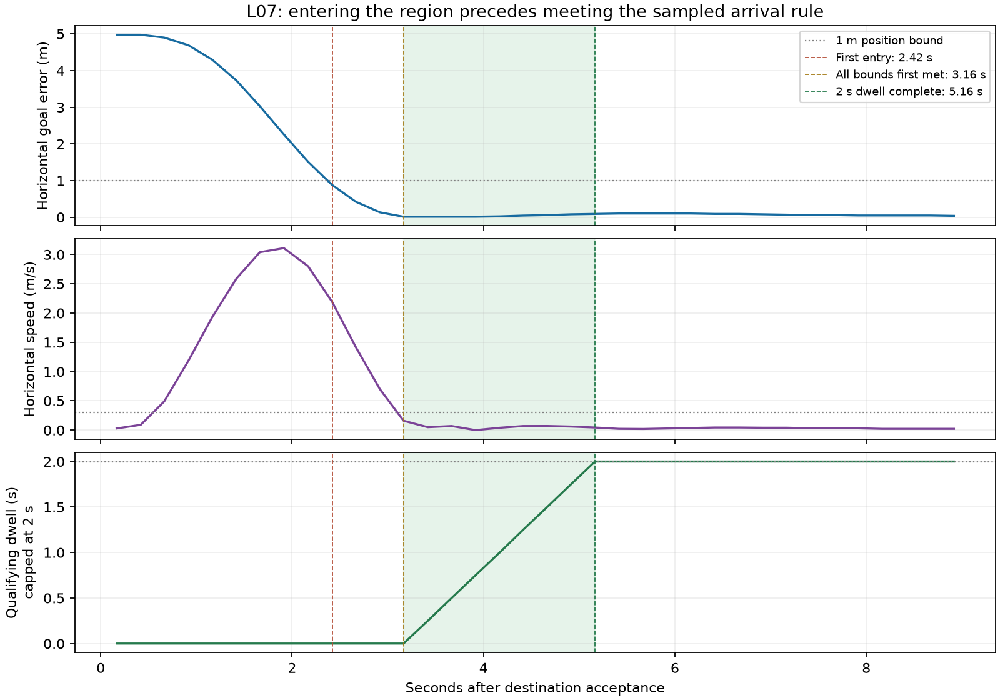

# L07 — Measure entry, stopping and held arrival

[Project](../../../README.md) · [Learning card](../../phases/learning/l07-measure-arrival.md) · [L05 stock route](../l05-one-coordinate/README.md) · [L06 speed comparison](../l06-one-speed-change/README.md)

Executed locally on 2026-10-31, approximately 18:37–18:40 America/Toronto (22:37–22:40 UTC), after the user explicitly requested pushing completed L06 and going to the next phase. L06 was published as `c26ffa094744a8c4122af60ab91ca13534b3d9f9`; remote/local SHA comparison passed, and `main` stayed at `c45c9e19ae279011d5779fa2669df3fac0f21a29`. L07 is local, uncommitted work on `codex/l07-measure-arrival`, branched from that L06 commit. L06 publication approval does not publish L07.

**Flight/measurement exercise and guided learner checkpoint complete.** The same stock GUIDED goal was approached with the L05 configuration, a predeclared position/speed/dwell rule was observed, then LAND/on-ground/automatic disarm and owned-session cleanup were confirmed. No controller or firmware parameter change was introduced. L07 is complete; L08 has not started. P01/P03 broader gates remain open.

## Concept and prediction before launch

Being near the destination is not sufficient evidence of a controlled stop: the vehicle may still be moving through that region. Completion for this scenario requires measured position, speed and an interval of held conditions. Earlier phases observed a manually selected five-second hold after settling; L07 fixes the rule before flight and measures the first region entry, the first low-speed state and the earliest completed dwell separately.

The predeclared prediction was that the vehicle would first enter the 1 m region while still travelling faster than 0.3 m/s. Arrival under the declared rule would occur later, after slowing and keeping all conditions for two seconds of valid, closely spaced telemetry. [Arrival contract](arrival-contract.json) and [goal declaration](goal-declaration.json) were written before the simulator was launched.

## Fixed scenario and arrival rule

The same destination was used: latitude **-35.3632172°**, longitude **149.1652374°**, altitude **3 m above home**, frame 3 GLOBAL_RELATIVE_ALT. This is roughly 5 m north of the nominal starting location. The scene, built-in quad model, source/submodules, speedup 1 and stock flight configuration match L05. WP_SPD was queried as 10 m/s and GUID_OPTIONS as 0. No parameter-write commands were issued. Automatic stock learning/statistics can still update during flight, as explained in L06.

| Required observation | Fixed condition |
| --- | --- |
| Horizontal distance from goal | ≤1 m |
| Height above home | 3 m ±0.2 m |
| Horizontal speed | ≤0.3 m/s |
| Absolute vertical speed | ≤0.2 m/s |
| Mode/arming/landed state | GUIDED, armed, IN_AIR |
| Position validity | GPS fix ≥3, EKF absolute-horizontal-position flag 16, non-placeholder latitude/longitude |
| Maximum received-message ages | GPS/EKF≤1 s; heartbeat≤1.5 s; landed state≤1 s |
| Maximum consecutive position gap | ≤0.5 s in both vehicle boot time and reception time |
| Dwell | At least 2 s spanned in both time bases, with every recorded sample satisfying all conditions |

Position was requested at 4 Hz and landed state at 2 Hz. A condition failure, stale/invalid state, excessive gap or non-increasing position boot time resets the offline dwell accumulation. Missing values are never filled or interpolated. Received-message age is not an independent end-to-end sensor-age qualification. This is an explicit rule for sampled telemetry, not a guarantee of physical state at unobserved instants.

The decision was bounded: if not observed within 30 s of destination acceptance, retain failure and use the qualified stock LAND path without bypass. After arrival, observe at least 5 additional seconds in GUIDED before requesting LAND. No fault injection, generalized arrival runtime or automatic test suite was introduced. The local analysis reads logs and sends no messages; it is not authoritative flight mission logic.

## Launch and exact operator commands

Reused L02’s existing environment/build: macOS 15.7.7 arm64, Python 3.12.12, MAVProxy 1.8.75, pymavlink 2.4.50 and unchanged Copter-4.7.2 at `fb773567896014da007bca58358704d4a0d8516f`, with all 21 recursive submodule pins preserved. No build/install/update was needed. Startup scripts were absent and no existing simulator/controller or occupied endpoint was found before launch. The passive recorder was started first:

```sh
.local/l02/venv/bin/python .local/l07/capture.py
```

It receives the UDP 14550 forward into `.local/l07/run1/observations.jsonl`, flushing each message. The flight-session entry point remained the stock launcher:

```sh
l07_root="$PWD"
l07_run_dir="$l07_root/.local/l07/run1"
env -u DISPLAY SITL_RITW_TERMINAL=bash TMPDIR="$l07_run_dir/"   PATH="$l07_root/.local/l02/venv/bin:/usr/bin:/bin:/usr/sbin:/sbin"   /usr/bin/script -q "$l07_run_dir/console.log"   "$l07_root/.local/l02/venv/bin/python"   "$l07_root/ardupilot/Tools/autotest/sim_vehicle.py"   -v ArduCopter -f quad -N --use-dir "$l07_run_dir"   --no-extra-ports --out 127.0.0.1:14550   --mavproxy-args=--default-modules=log,param,mode,arm,rc,cmdlong,output
```

The experiment and each flight action were explained before execution. Main console sequence, with actual waits/state checks retained in the [transcript](console.txt):

```text
long SET_MESSAGE_INTERVAL 245 500000
long SET_MESSAGE_INTERVAL 33 250000
long SET_MESSAGE_INTERVAL 32 250000
set guided_use_reposition true
set flytoframe AboveHome
set height_unit m
# Waited until both EKF3 IMUs reported using GPS.
arm prearms
status GPS_RAW_INT
status EKF_STATUS_REPORT
status SYS_STATUS
status EXTENDED_SYS_STATE
param show WP_SPD
param show GUID_OPTIONS
long REQUEST_MESSAGE HOME_POSITION
long REQUEST_MESSAGE GPS_GLOBAL_ORIGIN
mode guided
arm throttle
# Confirmed armed; then promptly:
takeoff 3
# Confirmed settled height/IN_AIR before the one destination:
guided -35.3632172 149.1652374 3
# Observed first entry, low speed, completed 2 s dwell and extra hold.
mode land
# Waited for ON_GROUND and automatic disarm.
param show WP_SPD
long REQUEST_MESSAGE HOME_POSITION
long REQUEST_MESSAGE GPS_GLOBAL_ORIGIN
status
```

MAVProxy’s three `set` commands restate the L05 console defaults; they do not write firmware parameters. The console was the sole flight-command source. Stock ArduPilot controlled the vehicle throughout. No prearm failure or command rejection was reported in this run, and all 13 received command acknowledgments were accepted. The two-second observed arrival rule is not a command acknowledgment or a new autopilot completion flag.

## Measured timeline

Times below are received-message times after the accepted DO_REPOSITION request. Fields come from GLOBAL_POSITION_INT and contemporaneous bounded-age mode/arming/landed/GPS/EKF observations; no SIM/SIMSTATE truth was used for this classification.

| Event | Time after acceptance | Position/speed evidence | Interpretation |
| --- | ---: | --- | --- |
| First entry into 1 m region | 2.418 s | Error 0.880 m; horizontal speed 2.190 m/s; height 3.001 m | Inside the region but still moving too fast; full rule false. |
| First sample meeting all conditions | 3.164 s | Error 0.0144 m; horizontal speed 0.160 m/s; height 2.999 m | Start the measured dwell; one sample alone is insufficient. |
| Earliest completed dwell | 5.165 s | Nine qualifying samples, reception span 2.0007 s, boot span 2.001 s; speed 0.0447 m/s | Arrival under the predeclared sampled rule. |
| Continued qualifying hold | Next 17.254 s of received samples | 70 samples including the completion sample; error0.0240–0.1018 m; maximum horizontal speed 0.0447 m/s | All recorded samples remained within bounds until LAND; no dwell resets were observed. |
| LAND accepted | 22.458 s | Separate mode command, followed by descent | Arrival/hold preceded landing. |

Maximum recorded northward overshoot beyond the target was **0.1002 m**. The longest received position gap in the approach/hold interval was **0.2560 s**, below the 0.5 s bound; the boot-time gaps were also within the bound. Nine samples spanning two seconds do not establish an exact continuous two-second physical hold. There were no stale/invalid qualification samples or gap resets after dwell began in this run; missing/stale-data failure cases were not injected or independently qualified.



This graph was generated after the flight by our local `.local/l07/plot-arrival.py` using Python/Matplotlib from [arrival-timeline.csv](arrival-timeline.csv). The green interval shows the required dwell; the displayed dwell is capped at 2 s. Lines connect samples for readability and do not add measurements between them. [Arrival analysis](arrival-analysis.json) retains exact first-entry/start/completion samples, state ages, both time spans, gaps, overshoot and continued-hold metrics. Our `.local/l07/analyze-arrival.py` performs passive analysis of the manual recording, not flight control or automated testing. [Full trajectory](trajectory.csv) and [full-flight chart](coordinate-flight-trajectory.png) retain the wider takeoff/approach/landing context.

## Waypoint indicator versus the declared rule

No MISSION_ITEM_REACHED message was observed between destination acceptance and LAND in the received vehicle stream. This is consistent with the selected stock GUIDED position path (`GUID_OPTIONS=0`), not a fabricated success marker or a reason to switch modes merely to force one.

The pinned source shows different branches:

- [GUIDED mode dispatch](https://github.com/ArduPilot/ardupilot/blob/fb773567896014da007bca58358704d4a0d8516f/ArduCopter/mode_guided.cpp#L64) The TakeOff, WP and Pos submodes run separate routines.
- [Waypoint reached notification](https://github.com/ArduPilot/ardupilot/blob/fb773567896014da007bca58358704d4a0d8516f/ArduCopter/mode_guided.cpp#L85) The notification is sent in the WP branch after reached_wp_destination, not the selected Pos branch.
- [Position-versus-waypoint option](https://github.com/ArduPilot/ardupilot/blob/fb773567896014da007bca58358704d4a0d8516f/ArduCopter/mode_guided.cpp#L670) WPNavUsedForPosControl is an option; default GUID_OPTIONS=0 selects ordinary position control.
- [Destination setup](https://github.com/ArduPilot/ardupilot/blob/fb773567896014da007bca58358704d4a0d8516f/ArduCopter/mode_guided.cpp#L466) The accepted global location is converted and stored as the position target for the default path.
- [Position hold controller](https://github.com/ArduPilot/ardupilot/blob/fb773567896014da007bca58358704d4a0d8516f/ArduCopter/mode_guided.cpp#L735) The stored target is fed into position controllers and attitude control for continued holding.
- [Waypoint path progress/reached state](https://github.com/ArduPilot/ardupilot/blob/fb773567896014da007bca58358704d4a0d8516f/libraries/AC_WPNav/AC_WPNav.cpp#L527) This other branch can mark fast waypoints complete from path-generator progress; regular waypoints also check waypoint radius. It does not implement our exact position/speed/2s contract. L07 did not fly this branch.
- [Reached-flag accessor](https://github.com/ArduPilot/ardupilot/blob/fb773567896014da007bca58358704d4a0d8516f/libraries/AC_WPNav/AC_WPNav.h#L233) This returns the WP navigation reached-state flag, not our offline dwell qualification.

[Source manifest](source-manifest.json) records the pinned symbols, lines and hashes. The [MAVLink message definition](https://mavlink.io/en/messages/common.html#MISSION_ITEM_REACHED) identifies a reached mission item; it does not supply this scenario’s complete measured arrival contract. The [official GUIDED documentation](https://ardupilot.org/copter/docs/ac2_guidedmode.html) and actual pinned branches were checked before flight. We qualify only what was received and source-inspected; no direct runtime trace or absolute packet-delivery proof is claimed.

A generic waypoint flag must therefore be interpreted according to its actual mode and semantics. In this run the required result is demonstrated by position, low speed and held valid samples, without assuming an unavailable waypoint flag. Merely passing near the coordinate at 2.19 m/s would not meet the rule even if some other mode reported a waypoint reached.

## Logs, invalid startup data and limitations

[Run results](run-results.json), [command/state events](command-state-events.json), [onboard log summary](onboard-log-summary.json) and [raw-artifact manifest](raw-artifacts.json) retain commands, timestamps, full-run metrics and raw paths/hashes. The run contained 649 global-position samples, 181 vehicle heartbeats, 52 armed heartbeats and 13 accepted command acknowledgments. The final saved estimator sample was 0.008 m above home with zero reported vertical speed, disarmed LAND and ON_GROUND. Onboard commands/disarm corroborate the received telemetry within the same simulated system, not independent verification.

The 106 startup position samples without a qualified absolute position remain in the full CSV with validity flags and blank derived distance values; they are not fabricated positions or arrival samples. The predeclared validity/freshness rules were not retuned after observing the flight. No hidden simulator truth was supplied as an autonomy input or used for the reported goal errors. Centimetre-scale agreement in this simulation is not physical GPS accuracy qualification.

Four MAVProxy startup parsing errors remain uninvestigated. Observed vehicle communication/error counters were zero, which does not erase those console errors or prove perfect packet delivery. Terrain requests remained pending/zero loaded. The unchanged stock GCS-link failsafe is disabled, so no lost-link response is qualified. This one nominal run does not qualify repeatability, fault handling, perception/avoidance, GPS-denied operation, native custom firmware or hardware. L07 adds no automated tests, snapshots, test scaffolding, UI, Gazebo, ROS or new dependencies. SkyDive and FeatherLaneFlight were untouched.

## Cleanup, rollback and maintained status

After fresh ON_GROUND/disarmed observations, matched owned simulator PID 13447, exact executable and `SIM_VEHICLE_SESSION=f1416b5ba0f454a1`, then sent SIGTERM only to that simulator. Ctrl-C closed MAVProxy/launcher; the passive capture was intentionally interrupted afterward (exit 130 with KeyboardInterrupt, per-message flush). Brief reconnect/connection-refused output followed deliberate shutdown. No session-owned processes or TCP 5760/5762/5763 and UDP 5501/14550 sockets remained. Stock listener binds were wildcard; no localhost-only network isolation or firewall change is claimed. No broad process kill was used.

Rollback needs no flight-parameter restoration because none was written; WP_SPD was observed as 10 both before flight and after landing. Stock automatic learning/statistics are retained, not reset to manufacture equality. Use a fresh empty run directory for a later stock session rather than reusing the learned EEPROM, and keep the pinned firmware and published L06 baseline. Full raw telemetry/DataFlash, capture/analysis helper source and run/dependency artifacts remain ignored under `.local/l07/`. L07 documents are local/uncommitted; no push/merge or physical operation occurred.

The canonical registry generates master/cards. `scripts/render-learning-plan.py` now abbreviates `ready_for_review` to “Review” only in diagram labels after the full status text exceeded the node’s readability limit; registry/cards retain the exact status. The initial failed validation is retained and regeneration passed all delivery/browser gates. The existing first-seven progress diagram is updated through installed Archify checks; no new architecture is proposed. [Execution summary](execution-summary.json) records final actual checks. Core architecture and UI/architecture approval flags remain unchanged. P01 still lacks remaining failure-handling evidence, and P03’s broader campaign/native/instrumented/UI work remains unqualified. L08 has not started.

## Guided learner checkpoint

Asked in this chat: **Why wasn’t entering the 1 m region at 2.42 seconds enough to count as arrival, and what additional evidence did we wait for?** The learner responded in this chat on 2026-10-31 that first entry was still too fast, a single later low-speed sample was insufficient and continued observations were needed before calling arrival. Guided clarification fixed the exact readings: all conditions first met at3.16s; speed only needed to be at or below0.3m/s rather than exactly zero; the required two-second dwell completed at5.16s. Dwell means remaining within the conditions over time, not a separate “3D trail.” This completes the guided checkpoint with correction; it is not an independent examination or proof between sampled observations.
