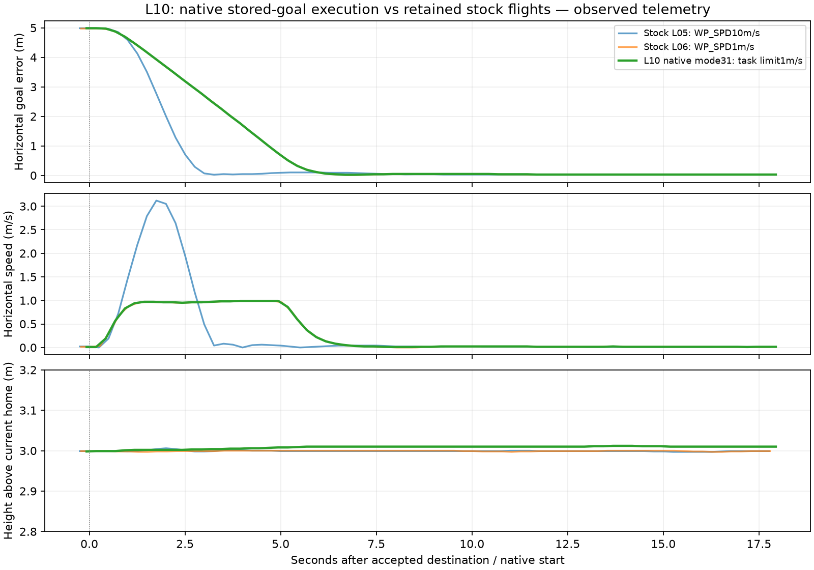

# L10 — execute one admitted native coordinate goal

Status: native execution/hold, operator LAND/disarm, exact-stock rollback and cleanup observed; ready for guided review. Guided learner checkpoint complete after clarification. AI-assisted C++/documentation. The user authorized L10 feature-branch publication on 2026-11-02, followed by local L11. Physical operation remains outside scope.

## Concept and prediction before the run

L09 validates and stores a task. L10 adds an explicit execution request and a small native mode adapter. Stock commands prepare flight: GUIDED, arm and takeoff to3m. USER_2 then requests the already stored taskID. The native adapter chooses its goal and limit; upstream Guided position/attitude control and motor mixing calculate movement. Only the selected native mode runs; a separate stock GUIDED instance is not simultaneously executing the task.

Prediction: after the existing stock takeoff/hold, USER_2 task1 selects mode31 (FeatherLane) and moves about5m north toward the L05 coordinate at the retained1m/s horizontal limit while holding roughly3m above admission-time home. Measured low-speed hold is external evidence here; native arrival/typed operator abort remains L11. The operator selects stock LAND, exits native execution and waits for automatic disarm.

[Predeclared execution contract](execution-contract.json) fixes request fields, entry/exit/reference policy, observable bounds, fallback and comparison limits before launch. The [core architecture](../../architecture/README.md) was updated and shown before code implementation.

## Entry points and necessary slice

```text
command_int GLOBAL_RELATIVE_ALT_INT USER_1 0 0 1 1 1 1 -353632172 1491652374 3
# prepare flight through the existing stock GUIDED / arm / takeoff commands
command_int MISSION USER_2 0 0 1 1 0 0 0 0 0
```

USER_1 remains admission-only. USER_2 (31011) is our project-local versioned start request: frame MISSION(2), version1 and stored taskID1; unused fields stay zero. The Copter receiver validates the source, transport, fields and ID, then calls `ModeFeatherLane::start_task`. It briefly grants an entry latch around normal `Copter::set_mode`. Direct selection of mode31 has no latch and is rejected. Normal mode-change authority/failsafe checks remain in that stock call path; explicit native checks remain active even when stock disarmed mode selection would ignore ordinary checks.

| Firmware file | Role |
| --- | --- |
| `ArduCopter/config.h` | Default mode enablement only for multicopter SITL with Guided available. |
| `ArduCopter/mode.h` | Project-local mode31, adapter interface and bounded local state. |
| `ArduCopter/Copter.h` | Owns/friends the adapter using existing mode conventions. |
| `ArduCopter/mode.cpp` | Registers the mode in stock lookup and available-mode reporting. |
| `ArduCopter/GCS_MAVLink_Copter.h` | Declares the explicit start receiver and includes its configuration dependency. |
| `ArduCopter/GCS_MAVLink_Copter.cpp` | USER_2 admission-to-execution mapping and standard ACK/status. |
| `ArduCopter/mode_featherlane.cpp` | Revalidates entry, installs the stored goal/limit, delegates to Guided, observes reference validity and relinquishes execution on exit. |

The native mode cannot arm/take off. It requires an already armed airborne stock GUIDED hover, speed<=0.3m/s, goal height within0.5m, goal within20m, GUID_OPTIONS0 and valid absolute position/altitude/home/origin without active failsafes. It preserves the saved admission home when deriving the absolute goal, with bounded<=0.5m home-reference changes. It sets the destination before applying the speed limit, because destination initialization loads stock limits. Stock Guided setpoints do not feed this mode (`in_guided_mode=false`), and stock speed setters reject while it owns execution. Operator mode changes remain available; a consumed task cannot restart silently after exit.

During execution the inherited Guided controller runs through the normal mode scheduler path; this adds no external authoritative flight state machine. A navigation/reference guard requests the existing stock LAND-with-pause path. Guard/reset/failure campaigns and hardware are unqualified; the normal flight, manual mode exit and selected harmless rejection cases are the scope here. RC_CONTINUE_IF_GUIDED does not classify this mode as Guided because its generic setpoint ingress is intentionally disabled; do not assume all Guided-specific failsafe options automatically apply.

## Baseline and build

L09 publication was remote-SHA verified: project `d8afe552351f4f246822857c49a6fa37edbc0bc7`, firmware `39cf614d1aae2ee4acb93f9294ebf66178967acb`. Main remains `c45c9e19ae279011d5779fa2669df3fac0f21a29`; stock firmware branch remains upstream Copter-4.7.2 `fb773567896014da007bca58358704d4a0d8516f`, with21 recursive pins unchanged. L10 is on local `codex/l10-native-known-goal` branches. No upstream update or publication of L10 occurred.

Build commands from `ardupilot/` use the retained Python environment and a separate output directory:

```sh
../.local/l02/venv/bin/python waf configure --board sitl --no-submodule-update --out="$PROJECT_ROOT/.local/l10/build"
../.local/l02/venv/bin/python waf copter -j4 --out="$PROJECT_ROOT/.local/l10/build"
```

The first build caught an undefined feature flag when the GCS header was included before Copter configuration. An explicit config include corrected that dependency; the complete subsequent build passed. Logs retain the initial failure and actual successful result. No tests or test scaffolding were added. Manual sessions and existing build/check facilities supply evidence.

## Actual observations and rollback

Initial mode29 and final mode31 nominal flights both accepted the stored goal, moved about5m north at the retained1m/s controller limit, and held. Duplicate USER_2 was idempotent; DO_CHANGE_SPEED returned FAILED and a flags0 DO_REPOSITION returned DENIED without changing the native goal/mode. Stock L05 and L06 trajectories are retained comparison inputs. The exact unchanged L09 executable and pure-stock executable remain available; selecting the latter demonstrates the original command behavior independently of the working L10 source.


The first nominal flight used project-local mode29 and performed the native movement/hold/LAND/disarm. The installed client maps29 to RATE_ACRO despite the pinned firmware not defining that mode. The final adapter therefore uses31, verified unmapped in both the selected firmware/client; this is a project-local ID rather than an upstream standard. Run1 source/binary/contract and its misleading client label remain separate evidence. A fresh final-source flight repeated the same declared scenario successfully.


## Operator-facing mode identity

The final heartbeat mode is31 and the firmware mode name is FeatherLane (`FLNE`). This installed MAVProxy uses a static mode-name table, so it displays `Mode(31)` for the project-local ID. It does not automatically learn the custom name. An AVAILABLE_MODES query did not produce a custom-name message in this recorded session; registration is source/build evidence, not a claim of observed dynamic discovery. The initial29 flight is retained with its RATE_ACRO client-label conflict and must not be mistaken for a stock rate-acro flight. The installed client mapping and pinned source were checked before selecting31.

## Scheduling and qualification limits

The adapter runs through the existing stock flight-mode update and delegates normal control to `ModeGuided::run()`. Its validity/reference checks use bounded existing APIs and local state; it adds no separate worker, external authoritative flight FSM, blocking inference or new scheduled task. GCS text is emitted on entry/exit/guard or explicit requests. No host CPU worst-case bound, latency gain or full failsafe equivalence is claimed. The reference/navigation fallback is source-inspected but not fault-injected here; broad link/GPS/reset/failsafe campaigns remain later qualification.

The inherited Guided implementation uses shared target/controller facilities across mode instances. L10 relies on the stock single-active-mode lifecycle and blocks generic Guided setpoints and stock speed setters while native execution owns that state. Explicit operator mode changes leave native execution through normal Copter cleanup. New movement/arrival/abort behaviors require separate qualification rather than assuming inheritance supplies their mission semantics.


## Measured final-source result

| Observation | Final mode31 flight |
| --- | --- |
| Goal selected inside firmware | −35.3632172°,149.1652374°;587.09m AMSL (3m above saved admission home) |
| Peak horizontal speed | 0.9901m/s |
| First sample within1m | 4.94s after accepted USER_2 |
| First sample meeting all bounds | 5.93s |
| Two-second sampled dwell completed | 7.93s |
| Subsequent qualifying hold | 50.27s /202 samples; maximum horizontal error0.0481m |
| Native modes recorded onboard | GUIDED4 → project-local31 → LAND9 |
| Exit | Operator LAND, native exit event, automatic disarm/on-ground |

The external hold criterion requires horizontal error≤1m, speed≤0.3m/s, absolute-height error≤0.2m and vertical speed≤0.2m/s, with fresh valid state and airborne native-mode telemetry. Dwell uses the smaller of reception/boot-clock elapsed times, rejects nonincreasing boot time and gaps>0.75s. This classifies recorded samples; it is neither an onboard arrival flag nor proof between samples. The native goal remains3m above admission-time home; a roughly1cm arming-time home update explains3.01m current-home telemetry.



I generated this graph offline with Python3.12 and Matplotlib3.11.2, using `.local/l10/analyze.py`, invoked from the project root as `.local/l02/venv/bin/python .local/l10/analyze.py`. The script reads the passive MAVLink recordings and retained L05/L06 CSVs; it sends no commands. The runtime chain was `sim_vehicle.py` → custom native `arducopter` + built-in quad physics → MAVProxy → UDP14550 passive recorder → JSONL → analysis/CSV/Matplotlib PNG. The graph is not a MAVProxy map or simulator rendering. Exact helper/input paths and hashes are in [raw-artifacts.json](raw-artifacts.json); raw sessions/helper scripts remain ignored local evidence.

The comparison overlays retained stock L05 WP_SPD10m/s (3.12m/s peak), stock L06 WP_SPD1m/s (0.99m/s peak) and native L10 task limit1m/s (0.99m/s peak). L10 closely follows the stock1m/s trajectory. Each is aligned to its accepted destination/start command; stock landing samples are excluded. Different sample/command timing and altitude references prevent interpreting this as a latency/reliability improvement or an identical arrival-campaign comparison.

## Parameters, logs and actual rollback

[Parameter comparison](parameter-comparison.json) retains1370 before/after values per native session. WP_SPD stayed10m/s and GUID_OPTIONS stayed0; no operator `param set` was issued. The native adapter applies its1m/s runtime controller limit after installing the destination, without rewriting WP_SPD. Other parameters changed: automatic compass declination, MAVLink stream rates, learned hover throttle and stock usage statistics. The before files are MAVProxy's cached initial list; the after files follow a fresh fetch, so their differences do not establish exact update times.

Those changes are consistent with pinned upstream code: `Compass::try_set_initial_location` sets declination after a usable location; `GCS_MAVLINK::handle_request_data_stream` updates stream-rate parameters from client requests; `AP_MotorsMulticopter::update_throttle_hover` learns hover throttle; `AP_Stats::flush` persists flight/runtime/distance statistics. The sessions retain the actual differences rather than claiming every parameter stayed unchanged. See source at `libraries/AP_Compass/AP_Compass.cpp`, `libraries/GCS_MAVLink/GCS_Param.cpp`, `libraries/AP_Motors/AP_MotorsMulticopter.cpp` and `libraries/AP_Stats/AP_Stats.cpp` in the pinned checkout.

[Onboard logs](onboard-log-summary.json) independently retain MODE/MSG/RCOU evidence from the native executable. This is a second recorded channel from the same simulation, not an independent external validation. [Rollback](rollback-summary.json) ran the exact pure-stock executable for95.06s /98 disarmed STABILIZE heartbeats: USER_2 returned UNSUPPORTED, selecting31 failed with `No such mode31`, and no FL status appeared. This rollback session was disarmed; stock-flight comparisons come from retained L05/L06, not a newly invented rollback flight. The retained L09 binary also remains available.

## Review packet and remaining learning step

- [Exact seven-file native patch](native-goal.patch), [source/submodule manifest](source-manifest.json), [binary identities](binaries.json).
- [Predeclared contract](execution-contract.json), [detailed execution summary](execution-summary.json), [run2 trajectory](run2-trajectory.csv), [run2 dwell timeline](run2-arrival-timeline.csv).
- [Run1 console](run1-console.txt), [final run2 console](run2-console.txt), [run2 launcher](run2-launch.zsh), [initial build failure](build-initial.txt), [successful final build](build-final.txt).
- [Rollback console](rollback-console.txt), [raw artifact hashes](raw-artifacts.json), [cleanup](cleanup.json).
- [L09 publication verification](publication-verification.json), [final consistency/diagram checks](verification.json).

All owned sessions were stopped only after fresh disarmed/on-ground telemetry. No selected sockets or owned simulator processes remain. The initial29 source and its label conflict are preserved separately from final31. No new automated tests, hardware operation or L10 push occurred.

The guided checkpoint is complete after clarification: which native code selected the destination, and which upstream components calculated motion and motor output? L11 remains planned and unstarted. L10 adds execution ownership; the next slice adds native arrival/dwell and one explicit operator-abort transition.
