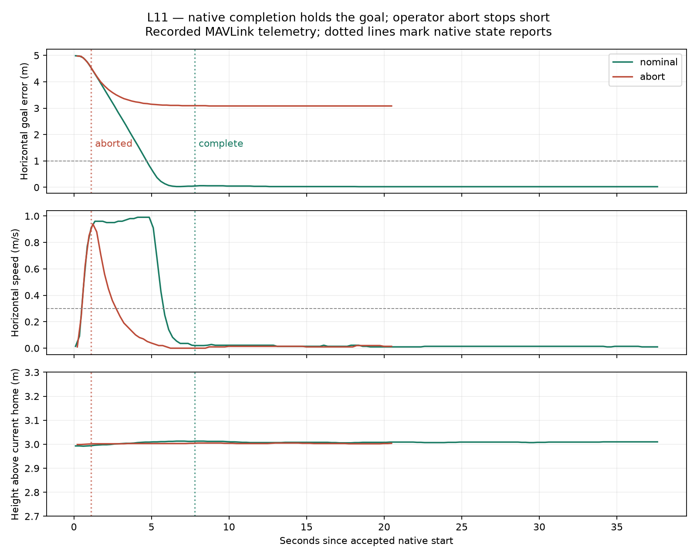

# L11 — native arrival and one operator abort

Status: final-source native build, nominal arrival/continued hold, operator abort/BRAKE stop, LAND/disarm and exact-L10 rollback observed; ready for guided review. Guided checkpoint pending. AI-assisted C++ and evidence tooling; no automated tests added. L11 is local/unpublished.

## Concept and prediction

L10 gave the native mode the stored destination. L11 adds an in-process task lifecycle: RUNNING, DWELLING and COMPLETE while the same flight mode keeps holding. Completion requires measured bounds for two seconds; it does not select LAND or disarm. One explicit USER_3 command aborts a running task by requesting stock BRAKE; only successful mode entry records ABORTED. Operator LAND remains separate. An external exit before completion is INTERRUPTED; invalid navigation/references/measurements latch the existing stock LAND-with-pause fallback. These guard/failure branches are source-inspected, not fault-campaign results.

The [predeclared contract](execution-contract.json) fixes the scenario, exact commands, limits, clock, abort semantics, duplicate behavior and fallback before launch. The maintained [core diagram](../../architecture/README.md) showed L11 proposed scope before implementation. No process, hosting or deployment change was introduced.

Prediction: after stock GUIDED takeoff/hover at3m, USER_2 executes the same goal5m north with1m/s limit, reports a two-second native dwell and COMPLETE, then holds until operator LAND. In a second fresh session, USER_3 during movement should select BRAKE and stop short of the goal; duplicates must not restart/rearm or change mode. The exact retained L10 executable should return USER_3 UNSUPPORTED in a disarmed rollback session.

## Code entry points

Four firmware files change against published L10: `ArduCopter/mode.h` adds typed task state and bounded local lifecycle data; `mode_featherlane.cpp` implements arrival/dwell and explicit BRAKE handoff; `GCS_MAVLink_Copter.h/.cpp` extend the existing receiver for USER_3 and state-aware replies. No controller, estimator or motor-mixer algorithm is replaced. Exact patch and source/binary identities are retained below.

```text
command_int GLOBAL_RELATIVE_ALT_INT USER_1 0 0 1 1 1 1 -353632172 1491652374 3
mode GUIDED
arm throttle
takeoff 3
# wait for measured low-speed3m hover before native entry
command_int MISSION USER_2 0 0 1 1 0 0 0 0 0
# abort-flight only, while still running:
command_int MISSION USER_3 0 0 1 1 0 0 0 0 0
# end each observed terminal hold explicitly:
mode LAND
```

USER_2 is31011; USER_3 is31012. Both require COMMAND_INT, configured GCS source, MISSION frame2, exact version1 and retained task ID, with unused fields zero under the existing contract. Normal mode-change checks remain active. BRAKE rejection returns DENIED and cannot report ABORTED; operator LAND is the declared fallback. An abort after COMPLETE is rejected, preserving the terminal result. A repeated accepted abort only reports retained ABORTED, including after later operator LAND.

## Native arrival and terminal semantics

The adapter reads estimated AHRS Location/finite NED velocity inside its scheduled mode update. Horizontal error must be within the retained radius1m, horizontal speed≤0.3m/s, absolute-height error≤0.2m and vertical speed≤0.2m/s. Existing home/origin/reset/navigation/failsafe guards remain active. AP_HAL::millis provides unsigned elapsed time; a callback gap>250ms or any bound violation resets dwell. Two seconds in bounds makes COMPLETE. This uses estimator API validity; it does not independently qualify every sensor timestamp or imply continuous physical containment between estimator updates.

COMPLETE retains the goal/controller loop while active. Later normal mode exit preserves COMPLETE; a later navigation/reference failure still invokes flight-safety fallback without rewriting the completed task result. ABORTED means the native mode yielded to BRAKE; actual stopping is separately measured. The task slot remains consumed after exit. No duplicate can install a new target or re-arm. Reconnection transport failures are not exercised in this slice.

## Build and preservation

The qualified upstream remains Copter-4.7.2 `fb773567896014da007bca58358704d4a0d8516f` and21 recursive pins. L10 is published at project `d0f30a8f1c33af2f54740fc2b0675f453e0d5ba2`, firmware `11573fb26ffe99022431a32d0b40502d03f9b02a`, with exact remote SHA/gitlink verification. Main and the stock firmware branch remain unchanged. Both L11 branches are local `codex/l11-native-arrival-abort`; the retained L10 and pure-stock executables are preserved.

From `ardupilot/`, the retained Python environment runs `waf configure --board sitl --no-submodule-update --out=$PROJECT_ROOT/.local/l11/build` then `waf copter -j4 --out=$PROJECT_ROOT/.local/l11/build`. The full build passed; the final-source incremental build also passed. Manual MAVProxy sessions operate the vehicle. External Python only records/reads/analyzes; it does not own flight state.

## Actual observations

The final-source nominal flight reported RUNNING at boot88132ms, DWELLING at93917ms and COMPLETE at95917ms: exactly2000ms native dwell, about7.79s after accepted start. Peak recorded horizontal speed was0.9902m/s. Another29.76s /120 sampled positions remained within the declared bounds, maximum horizontal error0.0620m. A duplicate USER_2 reported complete without reinstalling the goal. USER_3 after completion was denied; explicit operator LAND exited and automatically disarmed. A consumed USER_2 afterward was denied. Early admission before home was available was rejected and retained; later valid admission succeeded.

The fresh abort flight was moving at0.85m/s in the last position sample before the accepted abort. Native ABORTED/operator followed1.11s after start; onboard MODE records show31→17 (BRAKE), then operator LAND9. The external two-second low-speed stop completed4.11s after the abort acknowledgment. During the19.25s sampled BRAKE interval the minimum goal distance was3.084m, so the aircraft stopped short. Repeated USER_3 in BRAKE and again after LAND reported retained ABORTED without mode changes; repeated USER_2 was denied as consumed. There was no COMPLETE event in this interrupted run. Operator LAND automatically disarmed.

The exact retained L10 executable produced50 disarmed STABILIZE heartbeats over47.04s. USER_3 returned UNSUPPORTED; direct mode31 failed through L10's entry latch, confirming the existing mode remained registered. No L11 state event appeared. This was a disarmed rollback observation, not a new rollback flight. The L10 binary's embedded39cf614d build label reflects its precommit build baseline; its exact hash and recorded source patch identify the observed L10 code later published as11573fb2.

All sessions stopped only after fresh disarmed/on-ground telemetry. No owned simulator/recorder processes or selected sockets remain. Recorder Ctrl-C exits130 are expected shutdown, not vehicle faults. No further firmware edits occurred after the final build/source snapshot used for both flights.

## Compare observed arrival and abort



Python/Matplotlib generated this graph from the recorded MAVLink position/velocity data. Green is the nominal flight; red is the fresh abort flight. Dotted lines mark native state reports, not the instant physical stopping was achieved. The horizontal axis starts at each accepted USER_2. Both runs use the same goal, retained speed limit and height reference. Native dwell uses in-process AHRS updates; the lower-rate external CSV need not identify exactly the same first bounded sample. Reception timestamps also differ from native boot time. This is a pair of nominal/manual-intervention observations, not a reliability or latency-improvement campaign.

## Parameter, onboard and scope evidence

Both snapshots contain1370 parameters; WP_SPD remains10 and GUID_OPTIONS remains0. No operator parameter-set commands were issued. The runtime task limit remains1m/s. Actual cached-before/fresh-fetch-after differences are retained in [parameter comparison](parameter-comparison.json): stream rates, automatic declination, learned hover throttle and usage statistics, plus nominal barometer ground-pressure calibration and mission home storage count. These are consistent with existing upstream updates, not evidence that every parameter was frozen. `AP_Baro::calibrate` saves ground pressure; `AP_AHRS::set_home` calls `AP_Mission::write_home_to_storage`, which makes command count at least1. The snapshots do not establish exact update times, and MIS_TOTAL1 does not establish an AUTO route was flown.

[Onboard MODE/MSG and RCOU log summary](onboard-log-summary.json) provides another channel from the same simulation. MODE/MSG agree with the received native transitions and31→17 abort handoff; RCOU counts are734 nominal /700 abort. This is not independent external validation, a motor-control rewrite or proof of a scheduler CPU bound.

Native dwell resets, invalid-input/fallback paths, blocked BRAKE entry and external INTERRUPTED exit are implemented/source-inspected but not fault-injected in this slice. Native callback gaps are checked, while independent sensor-age qualification, arbitrary link/reconnect/reset/failsafe campaigns and hardware remain future work. COMPLETE preserves its result on normal exit while flight safety still retains authority. L11 adds no new scheduled worker or blocking inference/browser/slow-I/O path; worst-case host timing is unmeasured.

## Evidence entry points

- [Predeclared contract](execution-contract.json), [exact integration patch](native-arrival-abort.patch), [source/submodule manifest](source-manifest.json), [binary identities](binaries.json).
- [Nominal summary](nominal-summary.json), [nominal trajectory](nominal-trajectory.csv), [nominal console](nominal-console.txt), [nominal launch](nominal-launch.zsh).
- [Abort summary](abort-summary.json), [abort trajectory](abort-trajectory.csv), [abort console](abort-console.txt), [abort launch](abort-launch.zsh).
- [Rollback summary](rollback-summary.json), [rollback console](rollback-console.txt), [rollback launch](rollback-launch.zsh).
- [L10 publication verification](l10-publication-verification.json), [final checks](verification.json).
- [Initial full build](build-initial.txt), [final-source build](build-final.txt), [configure](configure.txt), [cleanup](cleanup.json), [raw artifact hashes](raw-artifacts.json).

The guided checkpoint is complete after clarification: a COMPLETE task can still be airborne; the existing controller continues holding until operator mode change. L12 has not started. L11 remains uncommitted/unpublished on its local feature branches.

Graph/CSV analysis uses Python3.12/Matplotlib in `.local/l11/analyze.py`, invoked from the project root with `.local/l02/venv/bin/python .local/l11/analyze.py`. Passive `.local/l11/capture.py` listens at `udpin:127.0.0.1:14550`. Raw sessions and helper scripts remain ignored local evidence; public curated artifacts retain actual observations and hashes. This is native macOS SITL with the built-in quad physics, not Gazebo, a map UI or hardware.
