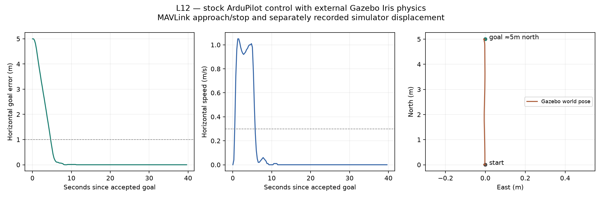

# L12 — connect one instrumented simulator scene

Status: native Mac headless Gazebo/official-plugin/stock-SITL flight, fresh disarmed connection and basic-SITL rollback observed; guided checkpoint complete. Guided checkpoint complete. L12 remains local/unpublished. AI-assisted build/world/launch configuration and evidence analysis; no automated tests or firmware edits added.

## What changed and what was predicted

Until L11, the selected basic SITL executable supplied both autopilot control and its built-in quad physics. L12 runs the existing JSON simulator model inside that same stock autopilot executable and a separate Gazebo server process. Gazebo's official ArduPilotPlugin receives actuator/PWM packets on local UDP9002, applies motor control to Iris physics and returns simulated state/IMU data. ArduPilot still estimates state and calculates flight/motor control. MAVProxy remains the operator console; Python only records/reads/analyzes.

The [predeclared contract](execution-contract.json) fixed the scene, source pin, profile, commands, measured bounds and fallback before flight. The [core architecture](../../architecture/README.md) and [phase deployment diagram](../../assets/learning/l12-simulator-deployment.svg) showed proposed scope before implementation. No cloud/remote host, physical vehicle, separate authoritative flight FSM or product UI was introduced.

Prediction: disarmed physics/IMU/clock exchange, then stock GUIDED takeoff3m, hover, the retained nearby goal5m north with WP_SPD1m/s, sampled stopping/hold, explicit LAND/disarm. One fresh disarmed scene connection and a return to basic SITL check reproducibility/rollback without claiming multiple flights or full reliability.

## Actual qualified tuple and entry points

| Part | Observed selection |
| --- | --- |
| Host | macOS15.7.7 arm64, AppleClang17.0.0 |
| Simulator | Gazebo Sim8.10.0; gz-physics7.5.0 with DART6.19.5 |
| Transport | gz-transport13.5.0; existing SITL JSON / loopback UDP9002 |
| Official plugin | `f116b03552d05c8d0b0bed5ed67033a1183121d1`, unchanged source |
| Flight executable | Exact preserved stock Copter-4.7.2 `fb773567896014da007bca58358704d4a0d8516f` build |
| Packages |269 native conda-forge packages in ignored local environment, exact URLs/hashes retained |
| Plant/profile | Official Iris QUAD/X; plain ground/IMU world; WP_SPD1, PLND_ENABLED0, RNGFND1_TYPE0 |

[Setup/build/launch guide](../../../simulation/gazebo/README.md), [source lock](../../../simulation/gazebo/source-lock.json), [exact package lock](../../../simulation/gazebo/conda-osx-arm64.lock.txt), [world](../../../simulation/gazebo/worlds/l12-baseline.sdf), [Gazebo launcher](../../../simulation/gazebo/run-gazebo.sh), [SITL launcher](../../../simulation/gazebo/run-sitl.sh).

The dependency environment and micromamba cache stay under `.local/l12/`; no shell startup file or broad Homebrew trust was changed. The examined Homebrew route was not used to install Gazebo; its temporary tap was removed. The minimal CMake wrapper builds only the actuator/state bridge from unmodified official source. The initial micromamba-run option ordering failed before build; that log is retained. Corrected configuration and plugin compilation succeeded, then the actual world/connection/flight ran.

L11 publication is exact-SHA verified at project `56b32a2c6d10bc58a85ae4ebab4ff98520da3acc` and firmware `a00f32be2a91639c8dee1c41c09e1c5e5635d547`. Both current local branches are `codex/l12-instrumented-scene`. Firmware HEAD/source remain unchanged from published L11; the qualification flight deliberately used the retained pure-stock binary. Main and all21 recursive upstream pins remain unchanged. [Publication verification](l11-publication-verification.json).

## Actual observations

SITL reported JSON timestamp/IMU/position/quaternion/velocity fields, connected to UDP9002 and reported QUAD/X. Gazebo loaded the official plugin, discovered the nested Iris IMU, published model/joint/clock topics and recorded world state. Early prearm acceleration inconsistency appeared during initialization and subsequently cleared; ordinary arming was accepted without disabling checks. The passive recorder's first attempt preceded its directory creation; the MAVProxy log retains startup, the corrected passive recorder covered the entire flight, and later sessions created directories first.

| Flight measurement | Actual result |
| --- | --- |
| Stock takeoff/hover | About3m above home, low horizontal/vertical speed |
| Peak horizontal speed after goal |1.05m/s against the1m/s target |
| Two-second sampled arrival dwell completed |7.80s after accepted DO_REPOSITION |
| Subsequent qualifying hold |31.83s /128 samples; maximum horizontal error0.0446m |
| Gazebo hover pose |About north0.006m, east−0.004m, world z3.190m |
| Gazebo goal displacement |About5m north; recorded north extent5.0134m, east magnitude<0.01m |
| Exit |Explicit LAND, automatic disarm and on-ground telemetry |

The speed target is not an exact measured speed or guaranteed hard cap. The changed Iris plant/profile produced a small speed overshoot; it was recorded rather than hidden. The sampled arrival gate requires error≤1m, horizontal speed≤0.3m/s, height error≤0.3m, vertical speed≤0.3m/s, fresh GPS/EKF/mode/landed state and a continuous two-second sampled span with≤0.75s gaps and increasing boot time. The smaller of reception/boot elapsed times is used. This is external scoring of the stock flight, not a new native completion implementation.

I generated this graph with Python3.12/Matplotlib using `.local/l12/analyze.py`, run as `.local/l02/venv/bin/python .local/l12/analyze.py` from the project root. The first panels read MAVLink telemetry; the plan view reads separately recorded Gazebo model poses. These channels share the same simulated plant and do not constitute independent physical validation. The plan view has a magnified east axis and no time-alignment/latency claim. Gazebo world z includes the model's roughly0.195m ground pose, while MAVLink height is relative to home;3.19m world z and3m above home are consistent.

The fresh external-scene repeat retained88 disarmed heartbeats over85.59s, with healthy clock/IMU/position exchange and no flight commands. Basic-SITL rollback retained89 disarmed heartbeats over86.04s, reported QUAD/PLUS and restored FRAME_TYPE0 /WP_SPD10 in its fresh original profile. Gazebo was absent from that rollback. This is one flight plus repeated disarmed startup/cleanup, not a repeated-flight campaign.

## Limits and evidence

DART logged that the official Iris mesh `base_collision` could not be created; primitive leg/rotor collision elements exist and a flat-ground landing was observed. Body/obstacle collision qualification is not established. GUI/rendering/camera, obstacle sensing/avoidance, AI/ROS, native L11 transfer to this changed plant, fault campaigns, host CPU/load guarantees and hardware were not exercised. JSON carries privileged simulator state into SITL; no sensor-only autonomy claim is made. The package install/build alone is not the flight evidence.

[Onboard MODE/RCOU summary](onboard-log-summary.json) is another channel from this simulation. RCOU count947 records actual autopilot output; JSN1/JSN2 were absent from this selected build/log and are not claimed. [Parameter comparison](parameter-comparison.json) preserves actual cached-before/fresh-after differences rather than asserting all parameters stayed frozen. [Binary identities](binary-identities.json) distinguish plugin, stock and preserved native executable hashes.

- [Flight summary](flight-summary.json), [MAVLink trajectory](trajectory.csv), [Gazebo poses](gazebo-poses.csv), [flight console](flight-console.txt), [Gazebo console](gazebo-console.txt), [topic inventory](gazebo-topics.txt).
- [Fresh connection](repeat-summary.json), [repeat console](repeat-console.txt), [basic rollback](rollback-summary.json), [rollback console](rollback-console.txt).
- [Cleanup](cleanup.json), [verification](verification.json), [guided checkpoint](learner-checkpoint.json).
- [Plugin configure](plugin-configure.txt), [initial launcher/configure failure](plugin-configure-attempt1.txt), [plugin build](plugin-build.txt), [package identities](environment-packages.json), [raw artifact hashes](raw-artifacts.json).

All owned sessions stopped after fresh disarmed/on-ground evidence; Gazebo then exited via its owned launch session, and recorders stopped. No remaining scene/SITL/recorders or selected control sockets remain. Raw transport/state logs and the environment remain ignored local evidence; final source/world/launch/lock files and curated observations are reviewable.

The guided checkpoint is complete: which process calculates flight control, and which simulates the world? L13 has not started; L12 publication is not authorized.

## Primary references

[Official ArduPilot Gazebo integration](https://ardupilot.org/dev/docs/sitl-with-gazebo.html), [official plugin source at the selected revision](https://github.com/ArduPilot/ardupilot_gazebo/tree/f116b03552d05c8d0b0bed5ed67033a1183121d1), [Gazebo macOS installation](https://gazebosim.org/docs/harmonic/install_osx/), [conda-forge native Gazebo packages](https://anaconda.org/conda-forge/gz-sim8), [micromamba manual installation](https://mamba.readthedocs.io/en/latest/installation/micromamba-installation.html). These guide source/package selection; actual qualification is the bounded evidence above.

## Follow-up GUI probe

The user asked to see the3D interface after the headless qualification. A fresh server and GUI were launched without SITL or any flight commands. The GUI created its main window and loaded the world, but the default and requested-OpenGL attempts both logged Ogre renderer load errors; the runtime still selected Metal. Desktop observation was unavailable because the CUA native pipe failed, so no visible3D rendering success is claimed. Both owned launch sessions were stopped. [Probe summary](gui-probe-summary.json), [default log](gui-probe-default.txt), [OpenGL-request log](gui-probe-opengl.txt). This does not change the earlier headless flight qualification or establish GUI support.

The user subsequently answered the visibility question: “A window with the3D drone/scene.” Static3D GUI visibility is therefore human-confirmed despite the renderer error logs. The probe had already been stopped when that answer arrived. No flight was started in the GUI probe; the earlier headless flight, static GUI visibility and unavailable agent screenshot validation remain distinct evidence.
