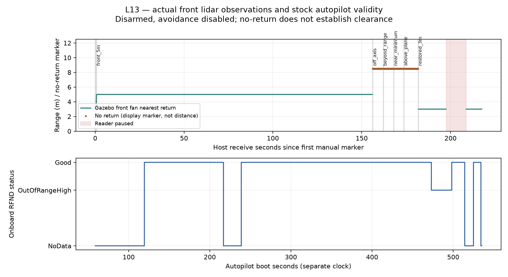

# L13 — observe one obstacle sensor

**Retention update — 2026-11-02:** generated CSV/TXT exports were removed at the user’s request. References below describe the original export provenance; retained summaries/figures and source/recording identities remain. See the [retention note](../README.md).

Status: implemented and manually observed locally on2026-11-02; sensor-disabled rollback and cleanup complete. Guided checkpoint complete after the under-range clarification. L13 was subsequently published on `codex/l13-obstacle-observation`. No flight, avoidance, firmware changes or automated tests were added.

## What runs, and where the information comes from

Gazebo Sim8.10.0 runs the L12 Iris physics/IMU plant with one added static box and front GPU lidar. The21-ray sensor publishes actual `gz.msgs.LaserScan` on `/l13/front_scan`. [range_observer.py](../../../simulation/gazebo/range_observer.py) validates and records those samples, converts the nearest return from metres to centimetres, and sends MAVLink `DISTANCE_SENSOR` on existing `tcp:127.0.0.1:5762`. The unchanged stock Copter4.7.2 executable consumes it through `AP_RangeFinder_MAVLink`. MAVProxy uses TCP5760 and forwards telemetry to the passive recorder on UDP14550. None of these L13 scripts sends a flight command.

The adapter reads no box poses or target labels. Manually selected box geometry is separate offline evaluation truth. This is an observation integration, not AI navigation, obstacle avoidance or sensor-only autonomy. The [phase process diagram](../../assets/learning/l13-obstacle-observation.svg) ([editable source](../../phases/l13-obstacle-observation.json)) details this slice within the [maintained core architecture](../../architecture/README.md). Proposed scope was shown before implementation; detailed design approval flags are unchanged.

The [predeclared contract](execution-contract.json) fixes21 rays across±5deg, one horizontal plane,10Hz,0.2–8m range, sensor mounting and a0.1m comparison tolerance. Mounting is Gazebo FLU `(0.3,0,0.15)m` relative to the body; the autopilot FRD parameter offset is `(0.3,0,-0.15)m`. Body forward points north initially. The added link has0.01kg mass; no flight transfer of this altered plant is claimed.

## Entry points

Use the [world](../../../simulation/gazebo/worlds/l13-observation.sdf), [parameter profile](../../../simulation/gazebo/l13-observation.parm) and the already qualified L12 dependency/plugin environment. From the project root, in separate terminals with a fresh run directory:

```sh
simulation/gazebo/run-gazebo.sh "$PWD/.local/l13/new-session" l13
simulation/gazebo/run-sitl.sh "$PWD/.local/l13/new-session" l13
.local/l02/venv/bin/python simulation/gazebo/range_observer.py \
  --record .local/l13/new-session/observer.jsonl
```

The launchers only start the processes. Keep this L13 qualification disarmed. Its profile sets `RNGFND1_TYPE=10`, forward orientation0, min0.2/max8, `PRX1_TYPE=0`, `AVOID_ENABLE=0`, `OA_TYPE=0` and disarmed logging. The actual observation run used retained local wrappers with these same paths/arguments before the common launchers gained their explicit `l13` selector. The common launchers' default L12 path was then manually exercised for rollback. [Setup guide](../../../simulation/gazebo/README.md).

To move only the static box, the manual Gazebo service command for the5m face was:

```sh
env GZ_PARTITION=featherlane_l13 GZ_IP=127.0.0.1 \
  MAMBA_ROOT_PREFIX="$PWD/.local/l12/mamba-root" \
  .local/l12/micromamba/bin/micromamba --no-rc run \
  -p "$PWD/.local/l12/gazebo-env" gz service \
  -s /world/l13_observation/set_pose --reqtype gz.msgs.Pose \
  --reptype gz.msgs.Boolean --timeout 2000 \
  --req 'name: "obstacle" position {x: 0 y: 5.55 z: 1}'
```

The box is2m east/west by0.5m north/south by2m high. At north5.55 its near face is5.30; subtract the sensor's0.30m forward offset to predict5.00m. [Case markers](case-markers.json) retain every declared position. These are scene operations, not vehicle setpoints.

## Actual readings and validity

| Manual case | Observed result after350ms settling |
| --- | --- |
| Stable restored3m face |351 returns at3.000184m; error0.000184m |
|5m face |1540 returns at5.000307m; error0.000307m |
| Box off to the side |54 no-return samples |
| Box front face10m away |55 no-return samples |
| Box front face0.1m away, below0.2m minimum |52 no-return samples |
| Box raised above the scan plane |77 no-return samples |
| Reader paused while physics/autopilot continued |Adapter stale after0.3557s from last receipt; onboard Good→NoData |
| Reader resumed |Actual3m returns and onboard Good recovered |

The early `front_3m` marker lasted only0.755s and overlapped the next manual move before its completion marker: its three selected samples include both3m and5m. That mixed window is preserved in the summary, not treated as a stable comparison. The later restored3m interval supplies the stable result. Numerical errors are ideal simulated-scene observations, not a calibrated real-sensor accuracy claim.

Positive-infinite rays mean **no return**, not a physical distance and not proof of free space. The below-minimum box is a concrete counterexample. The adapter maps this to801cm (`max+1cm`) only as the existing backend's out-of-range sentinel; the onboard log classifies it `OutOfRangeHigh`. That classification cannot distinguish near blindness from a distant/absent obstacle. No future controller may infer clearance from this result without additional qualification.

The21 rays span10deg horizontally in one plane. They do not cover the rear, sides, above/below, gaps between rays or the swept volume of the airframe. A2D target bounding box likewise does not establish metric distance or body clearance.



**Graph provenance:** I generated this PNG with Python3.12/Matplotlib using the maintained [offline analyzer](../../../simulation/gazebo/analyze_range_observations.py), run as `.local/l02/venv/bin/python simulation/gazebo/analyze_range_observations.py`. The upper panel reads the retained raw adapter observations; the lower panel reads actual onboard RFND records decoded from the retained BIN. The intermediate CSV exports have been removed. The panels use separate host-reception and autopilot clocks; they are not a synchronized latency plot. The shaded interval is the manual pause of the adapter's owned Gazebo topic-reader process, not the physics server. No-return markers are drawn above8m for visibility and are not obstacle distances.

## Freshness and downstream behavior

The official plugin's JSON range latch does not convey sensor age and would keep returning a latched range. This slice instead uses the existing [MAVLink backend](../../../ardupilot/libraries/AP_RangeFinder/AP_RangeFinder_MAVLink.cpp): it ages packets with its own AP clock and declares `NoData` after500ms without new packets. It accepts by orientation, not sensor ID; this qualification has one producer with that orientation.

The bridge enforces increasing simulator timestamps, expected frame/geometry, finite in-bound numeric returns or explicit positive-infinity no-return, bounded input buffering and a350ms receive-gap guard. It forwards new samples only while stock disarmed heartbeat state is fresh. Invalid/stale observations stop forwarding. The malformed-input and armed-vehicle guards were source-reviewed, not injected in this run. The source simulator clock, host monotonic clock and AP boot clock are not synchronized: receive freshness is observed, but capture-age/end-to-end latency and bounded transport delay are unqualified. Buffered complete lines are reduced to the newest available line; that is not a synchronized capture-age guarantee.

The onboard log contains9530 RFND records:7140 Good,502 OutOfRangeHigh and1888 NoData, including startup, observer1 stop, final-reader pause and final shutdown. For the final pause, Good becomes NoData at AP boot514.161701s and recovers at524.961701s. `NoData` stores distance0 as invalid state; it does not mean an obstacle at zero metres. The autopilot stops emitting DISTANCE_SENSOR while NoData, so a cached last packet must also be aged by its reader. Its output reports300/500/801cm and instance id0, and omits the original fan FOV metadata; consult the observation envelope/world for coverage.

All480 recorded heartbeats in the main session are disarmed, MODE stays STABILIZE and measured relative altitude stays0m. This demonstrates sensor observations and validity, not a motor/flight response.

## Rollback, identities and limitations

After fresh disarmed/on-ground evidence, only the owned observer, SITL, MAVProxy/launcher, passive recorder and Gazebo were stopped. A fresh default L12 world/profile then connected the exact stock executable with `RNGFND1_TYPE=0`; topic inventory had no `/l13/front_scan`. It remained disarmed/on-ground and was stopped. [Rollback and parameter record](verification.json) includes actual fresh values, state and cleanup.

The stock executable SHA remains `66388e5b874c16867992a31fdae17e17bdb9a9568935a40a9af3303543ef61ec`; the official plugin and all21 recursive upstream pins are unchanged. Firmware HEAD remains published L11 `a00f32be2a91639c8dee1c41c09e1c5e5635d547`, with no source diff. [Source/binary/raw identities](artifact-identities.json) preserve the initial observer1 source separately from the final observer2 source. The initial run exposed the stale-receive/backend timeout before the final buffer/exception-reporting refinements; final manual cases use observer2.

Gazebo logged Metal renderer errors but emitted the actual LaserScan samples above. DART's previously recorded missing mesh body collision remains a limitation. No collision/contact, flight transfer, avoidance, full-volume coverage, real sensor, GUI observation, fault campaign or reliability guarantee is established. No new dependency or automated tests were added. Shell/Python syntax, structured files, links, scoped diff, exact pins and existing artifact gates were checked; unchanged flight firmware did not require a new build.

L12 publication is verified at project `7b1dc4a07bb335c960c2e72f855b0e3bf07d6885` and unchanged firmware on the matching feature branch. **The user's screenshot is still not included:** macOS denied its TemporaryItems path; a readable reattachment/copy is needed. L13 is local/unpublished, and L14 avoidance has not started. [Learner checkpoint](learner-checkpoint.json).

The learner completed the checkpoint on2026-11-02: “Yes—the box could be inside the sensor’s0.2m minimum range.” This resolves the earlier suggestion that no-return could guarantee a clear3–5m region. L13 is complete locally; publication and L14 remain separate.


## Publication update —2026-11-02

The user authorized L13 publication and local L14. Published project `5e3a8fd6464fc6157a654e5714262272624177b1` and matching unchanged firmware `a00f32be2a91639c8dee1c41c09e1c5e5635d547` were remote-SHA verified. Earlier local/unpublished statements describe the original handoff. L14 records its modified observer profile and actual stock stopping flights separately; these L13 observations keep their original source identity. The screenshot remains pending a readable attachment.
