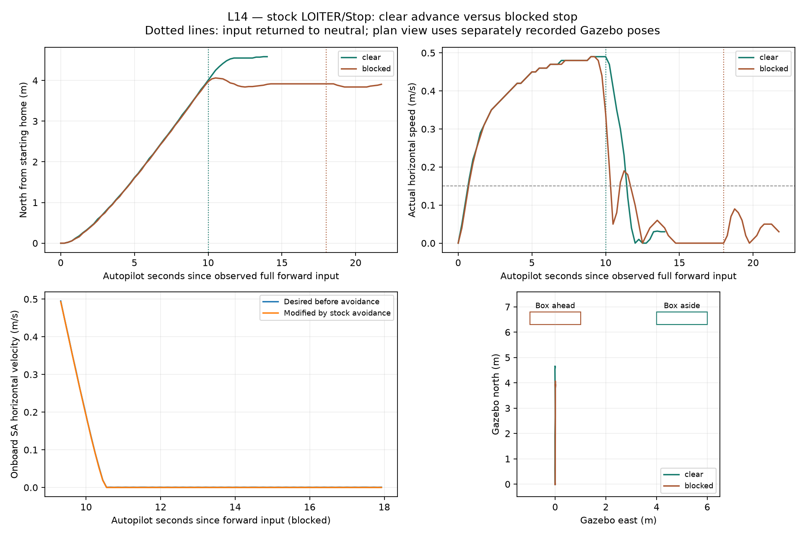

# L14 — stock LOITER stopping with a front obstacle

**Retention update — 2026-11-02:** generated CSV/TXT exports were removed at the user’s request. References below describe the original export provenance; retained summaries/figures and source/recording identities remain. See the [retention note](../README.md).

Status: completed and published on `codex/l14-stock-obstacle-stop` at project `681666aa52bf825ef170c00eb4324c6f435be535`, unchanged firmware `a00f32be2a91639c8dee1c41c09e1c5e5635d547`; remote SHAs verified. Guided checkpoint complete after the actual3D walkthrough. Flight/rollback sessions and the old playback are stopped. No firmware, custom planner or native-mode avoidance was added in L14; subsequent local L15 work is recorded separately.

## What this phase does

L13 supplied distance observations without movement. L14 connects the same front rangefinder to stock proximity and simple avoidance, then flies stock LOITER with an operator's forward input. In a clear corridor the vehicle advances; with the box ahead it stops while forward input remains held. This is a bounded stopping outcome, not an autonomous route around the box or completion of a coordinate mission.

The path is **Gazebo lidar → Python observation adapter → MAVLink rangefinder → stock proximity boundary → AC_Avoid → stock LOITER/controllers**. Python sends DISTANCE_SENSOR only. MAVProxy sends operator mode, takeoff, RC and LAND commands; the autopilot owns estimation and control. Known box geometry and simulator poses are used only for evaluation, never as adapter inputs.

The proposed [phase data-flow diagram](../../assets/learning/l14-stock-obstacle-stop.svg) ([editable source](../../phases/l14-stock-obstacle-stop.json)) was shown before implementation. This child view belongs to the [maintained core architecture](../../architecture/README.md); it introduces no new hosting/process placement. The [pinned C++ source walkthrough](../../guides/l14-stock-stop-source.md) explains the existing receiver, proximity and velocity-limiting calls. Detailed architecture approval flags remain unchanged.

## Exact configuration and entry points

The executable remains the exact preserved stock Copter-4.7.2 build from `fb773567896014da007bca58358704d4a0d8516f`, SHA256 `66388e5b874c16867992a31fdae17e17bdb9a9568935a40a9af3303543ef61ec`. Gazebo Sim 8.10.0, physics 7.5.0/DART 6.19.5, the isolated L12 environment and official plugin `f116b03552d05c8d0b0bed5ed67033a1183121d1` are unchanged. Firmware source remains published L11 `a00f32be2a91639c8dee1c41c09e1c5e5635d547`; no firmware rebuild/change was needed.

The [world](../../../simulation/gazebo/worlds/l14-stock-stop.sdf) retains the L13 21-ray, 10-degree planar front lidar over 0.2–8 m. The static box is 2 × 0.5 × 4 m, centred at ENU `(0, 6.55, 2)` for blocked and `(5, 6.55, 2)` for clear. Its front face is north 6.30 m; the sensor starts 0.30 m forward of the vehicle, predicting a 6 m initial return in the blocked scene.

The [final profile](../../../simulation/gazebo/l14-stock-stop.parm) selects:

| Setting | Value / purpose |
| --- | --- |
| RNGFND1_TYPE / orientation | 10 / 0: existing MAVLink front rangefinder |
| PRX1_TYPE | 4: existing rangefinders feed proximity |
| AVOID_ENABLE / AVOID_BEHAVE | 2 / 1: proximity avoidance, Stop |
| AVOID_MARGIN | 2 m target margin |
| AVOID_BACKUP_SPD | 0: backing away disabled |
| LOIT_SPEED_MS | 0.5 m/s requested speed limit |
| LOIT_ANG_MAX | 1.5 degrees: bound pilot-requested acceleration |
| OA_TYPE | 0: no BendyRuler/Dijkstra planner |

From the project root, in separate terminals using a fresh run directory:

```sh
simulation/gazebo/run-gazebo.sh "$PWD/.local/l14/new-session" l14
simulation/gazebo/run-sitl.sh "$PWD/.local/l14/new-session" l14
.local/l02/venv/bin/python simulation/gazebo/range_observer.py \
  --phase l14 --record .local/l14/new-session/observer.jsonl
```

The adapter's default L13 profile remains disarmed-only. The explicit L14 profile selects the new topic/frame/partition and permits these simulator flights; heartbeat freshness and sample validation remain active. It adds no mode/arming/target commands. Existing L13 evidence retains its original published source identity; it is not relabelled as a run of the modified adapter.

The operator sequence was normal GUIDED arming/takeoff to 3 m, a measured hover, neutral roll/pitch/yaw and throttle 1500, then LOITER. The final comparison used `rc 2 1000` for about 10 s clear and 18 s blocked, followed by `rc 2 1500`, a hold, explicit `mode LAND` and automatic disarm. Neutral was issued within the same timed tool action as the forward command in the final runs. This is a bounded operator experiment, not an external flight mission state machine. The clear corridor is an evaluated manual travel direction, not a newly implemented GPS mission.

For the clear case only, the static box was moved aside through Gazebo's `/world/l14_stock_stop/set_pose` service before flight. The blocked case uses the unchanged initial world pose. [Predeclared contract and explicit revisions](execution-contract.json) retain geometry, limits and the input/profile corrections made before the final flights.

## Actual final observations

| Measurement | Clear | Blocked |
| --- | --- | --- |
| Received full-forward interval / AP boot interval | 10.06 s / 10.00 s | 18.16 s / 18.00 s |
| Peak actual horizontal speed | 0.49 m/s | 0.49 m/s |
| Progress while forward held | 3.89 m | Maximum 4.06 m; then held near 3.9 m |
| Clear progress including the scored neutral hold | 4.59 m | — |
| Maximum height error from 3 m | 0.01 m | 0.01 m |
| Maximum lateral deviation | 0.010 m | 0.010 m |
| Two-second low-speed hold while forward held | Not expected | Completed at 13.75 s |
| Native SA avoidance records during input | 0 | 85 |
| Exit | LAND / automatic disarm | LAND / automatic disarm |

The blocked dwell requires at least 3 m approach progress, speed ≤0.15 m/s, height error ≤0.4 m, fresh navigation/mode/RC state, armed LOITER and RC2 still 1000 for two seconds, with ≤0.75 s sample gaps. This prevents counting the initial hover as an obstacle stop. The smaller of boot/reception elapsed times is used. [Final scoring](qualification-summary.json) passes the declared motion, timing, clearance and data-quality checks; it does not establish broad reliability.

Separately recorded Gazebo poses give a minimum blocked centre-to-box distance of **2.230 m**. Subtracting the predeclared 0.7 m horizontal disc radius gives a **1.530 m evaluation gap**. This is a geometric bound against one known primitive box, not a contact/mesh or real-airframe validation. Sensor readings reached **1.942 m**, briefly below the configured 2 m margin; the margin is not a hard measured-clearance guarantee. Those sensor and centre/envelope measurements describe different reference points.



**Graph provenance:** Python/Matplotlib generated this graph using [analyze_stock_stop.py](../../../simulation/gazebo/analyze_stock_stop.py), run as `.local/l02/venv/bin/python simulation/gazebo/analyze_stock_stop.py`. The upper panels read retained MAVLink trajectory/RC data. The lower-left panel reads actual onboard SA records before/after the current avoidance call. The lower-right reads separately recorded Gazebo poses and known box geometry; no cross-clock latency inference is made. The desired velocity entering each call can already reflect the previous call's limiting, so the two SA curves largely overlap. SA records, continued RC input and achieved stopping are separate evidence. All channels share one simulated plant and are not independent physical validation.

## Retained failures and limits

The initial RC2=1400 calibration produced only about 0.07 m/s. It was neutralized and excluded from comparison. The first blocked full-stick interval lasted 32.5 AP seconds, exceeding the planned 20 s operator bound between tool turns. It was retained and repeated with forward/neutral commands inside one timed action.

More importantly, the initial default-lean full-stick flights briefly peaked at **1.68 / 1.71 m/s**, exceeding the 0.65 m/s review bound despite LOIT_SPEED_MS=0.5. Those flights demonstrated stopping but failed the conservative speed criterion. The final profile adds only LOIT_ANG_MAX=1.5 degrees to limit pilot-requested acceleration, and both cases were repeated from fresh sessions. [Initial configuration and observations](initial-configuration/) remain distinct from the passing final configuration; their original raw logs and source/profile identities are retained locally. A configured speed target must be checked against actual motion.

Only a narrow front fan is measured. No-return still cannot establish clearance, including the under-range blind spot observed in L13. Stock proximity represents observations in coarser angular sectors; other PRX fields showing the maximum range are not evidence of measured coverage in those directions. The known, head-on box/corridor and conservative operator bounds are essential limits of this result.

No detour, globally feasible route, native ModeFeatherLane avoidance, position-waypoint avoidance, sensor-loss fallback, full failure campaign, GUI-observed flight or hardware is qualified. LOITER's limiter path does not automatically transfer to our Guided-derived native position mode. L15 must inspect and qualify its own selected path. DART's missing mesh body collision and renderer errors remain recorded. Front range data continued through the final flights; no in-flight dropout was injected. On stopping the final topic readers, the CLI emitted a C++ mutex error during teardown; the adapter/owned sessions exited and no processes/sockets remain. Passive recorder exit 130 reflects operator Ctrl-C.

## Rollback, publication and evidence

A fresh default L12 world/profile, without an observation adapter, restored RNGFND1_TYPE0, PRX1_TYPE0, AVOID_ENABLE3, AVOID_BEHAVE0, LOIT_ANG_MAX0 and LOIT_SPEED_MS12.5. It stayed disarmed/on-ground and had no front_scan topic. [Verification](verification.json) records the actual fresh values, original-profile comparison and all session shutdowns. [Artifact identities](artifact-identities.json) preserve final source/configuration, exact binaries, original and final runs and raw evidence hashes.

L13 publication is remote-SHA verified at project `5e3a8fd6464fc6157a654e5714262272624177b1` and matching unchanged firmware `a00f32be2a91639c8dee1c41c09e1c5e5635d547`. Main and all 21 recursive source pins are unchanged. L14 has local source-trace/configuration commits and uncommitted evidence; none is published. The screenshot remains pending a readable attachment. The [guided checkpoint](learner-checkpoint.json) is complete after the 3D walkthrough; L15 has not started.

[Official simple avoidance documentation](https://ardupilot.org/copter/docs/common-simple-object-avoidance.html) establishes supported LOITER/Stop configuration; the pinned local code and actual observations above establish this run's narrower result.

## Requested 3D walkthrough

The learner requested seeing the drone fly before completing the checkpoint (subsequently completed; see below). A Gazebo server and GUI were opened against the **actual blocked-final state recording**, without SITL or new flight commands. The initial combined process was rejected by Gazebo's macOS requirement; separate server/GUI launches loaded the recording. Playback is paused at simulation 55 s, where recorded pose data shows the drone at world z3.183 m (about 3 m above home), before its forward approach. [Playback entry points](../../../simulation/gazebo/replay-l14.sh) and [camera/control configuration](../../../simulation/gazebo/l14-playback-gui.config) make this reproducible.

The desktop tool still reports native-pipe startup failure, so the agent cannot verify visible rendering. The GUI logs the existing Ogre warnings. A visible-scene question is pending; no GUI-observed flight is claimed from successful process startup or pose service data alone. The earlier all-stopped statement concerns the flight/rollback sessions; this separately requested playback pair is intentionally open and paused for the user. [Gazebo's playback documentation](https://gazebosim.org/api/sim/8/log.html) describes the recorded-state workflow.

The user subsequently confirmed seeing the 3D drone and red box. The actual blocked segment was replayed from 55 s to about 81 s, then the actual clear segment was opened/replayed over the same interval. Recorded pose services confirmed north displacement toabout3.91m blocked and4.65m clear while remaining airborne. Human3D-scene visibility is confirmed; agent visual inspection and independent human confirmation of the entire motion remain distinct. The clear playback is currently paused after the approach. The mechanism checkpoint was subsequently completed after clarification.

AVOID_BACKUP_SPD0 disables the avoidance backaway command; small reverse position corrections can still occur while LOITER settles. The horizontal-speed graph shows magnitude, so a small settling bump is not evidence of a detour. The boxes have the same dimensions; only their placement differs.

The learner completed the final mechanism checkpoint on 2026-11-02: “The front distance readings, processed by stock avoidance in LOITER.” L14 is complete locally; L14 publication and starting L15 remain separate actions. The clear recorded playback remains paused for viewing.
