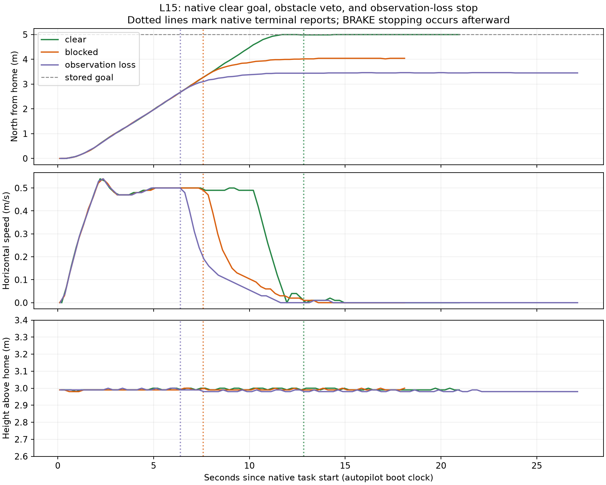

# L15 — native obstacle-stop integration

Status: implemented and manually observed locally on 2026-11-02; final clear/blocked/lost-observation flights ended with operator LAND and automatic disarm. Exact-stock disarmed rollback passed; owned sessions stopped. Guided checkpoint pending. L15 remains unpublished on `codex/l15-native-obstacle-stop` in both repositories. L14 and the CSV/TXT cleanup were published at project `681666aa52bf825ef170c00eb4324c6f435be535`, with unchanged firmware `a00f32be2a91639c8dee1c41c09e1c5e5635d547`.

## Concept and scope

L14 used stock LOITER, which already applies AC_Avoid to pilot motion. Our native mode uses the inherited Guided position path; that path does not automatically apply the same limiter. L15 explicitly checks the requested direction toward its retained goal through stock `AC_Avoid::adjust_velocity_NED_m`.

The adjusted local vector is a veto probe, never a replacement flight target. A restriction greater than 0.01 m/s requests stock BRAKE and records BLOCKED after successful mode entry. Missing, stale or unsupported observations request BRAKE and FAILED. Navigation/reference failures retain the previous LAND-with-pause fallback; rejected BRAKE entry also requests LAND. The native task still owns goal/arrival state, while existing controllers and motor mixing produce movement. There is no detour planner or semantic object recognition.

The [phase diagram](../../assets/learning/l15-native-obstacle-stop.svg), [editable source](../../phases/l15-native-obstacle-stop.json) and [frozen source walkthrough](../../guides/l15-native-stop-source.md) cover this integration. The proposal was shown before code. The [core architecture](../../architecture/README.md) remains the parent view; this slice adds no deployment location or worker.

## Selected inputs and bounds

The same Gazebo/official-plugin Iris QUAD/X scene and 21-ray, 10-degree planar front lidar are reused. Range is 0.2–8 m; no-return remains unknown. Only the known simulated corridor is qualified. The observation adapter supplies DISTANCE_SENSOR; simulator poses and box geometry are used exclusively for offline scoring.

Native entry requires exactly the selected MAVLink rangefinder/proximity profile and healthy navigation. During execution it checks backend status and autopilot receive age ≤350 ms, front-goal direction within 3 degrees, and roll/pitch within 5 degrees. Receive freshness does not establish synchronized capture age or authenticate a physical sensor. Other sensor profiles are rejected.

This slice allows a requested speed ≤0.5 m/s, arrival radius 0.5 m and entry distance ≤6 m. The selected goal is 5 m north, 3 m above admission-time home. A noncompleted task times out after 30 s. There is one consumed task slot and no automatic restart after stopping. The existing two-second arrival dwell and continued hold remain. Terminal task state is separate from later flight safety.

Final [parameters](../../../simulation/gazebo/l15-native-stop.parm) use WP_SPD0.5, WP_ACC0.25, AVOID_MARGIN2.25, Stop, no backup and no OA planner. The initial 2 m margin stopped with a 1.9947 m center gap, missing the predeclared ≥2 m criterion. That attempt is retained. We added 0.25 m settling allowance and repeated both comparison cases; the acceptance criterion was unchanged. See the [contract and explicit revision](execution-contract.json).

## Commands and entry points

MAVProxy remains the operator console. These commands admit one task, prepare flight through stock GUIDED, and explicitly start the native mode:

```text
command_int GLOBAL_RELATIVE_ALT_INT USER_1 0 0 1 1 0.5 0.5 -353632172 1491652374 3
mode GUIDED
arm throttle
takeoff 3
# wait for measured low-speed hover near 3 m
command_int MISSION USER_2 0 0 1 1 0 0 0 0 0
# after the observed terminal hold, end flight explicitly
mode LAND
```

Firmware changes are limited to `ArduCopter/mode.h` and `mode_featherlane.cpp`: typed avoidance/blocked outcomes, sensor/freshness checks, the stock-limiter probe, bounded timeout and explicit stop handoff. GCS contracts are unchanged. Native source is local commit `77df25587413ab6d0183c6583c92b3cf4ba7bcab`; the build reports `77df2558`. The [exact patch](native-stop.patch) is against published L11. The initial compile caught private AHRS fields; repository `get_*_rad()` accessors corrected them. Corrected and final-source builds passed. No automated tests were created or modified.

Maintained launchers accept `l15` and select `.local/l15/build/sitl/bin/arducopter`; L12–L14 retain the exact stock executable. Start each case with a fresh run directory/EEPROM. The clear case moves the box aside through Gazebo's set_pose service before flight. A separate Gazebo GUI used [the LIVE configuration](../../../simulation/gazebo/l15-live-gui.config); it was not a plotted animation or log playback. Launch logs show the GUI renderer started; the agent's desktop-viewing pipe remained unavailable, so no independent visual inspection or L15 learner visibility confirmation is claimed.

## Observed results

| Final case | Native outcome | Measured behavior |
| --- | --- | --- |
| Clear corridor | COMPLETE at12.843s; native dwell2000ms | Reached5m goal; another8.113s sampled hold, maximum goal error0.0112m. |
| Box ahead | BLOCKED/obstacle at7.598s; mode31→17 | Two-second low-speed stop completed2.752s after handoff. Minimum Gazebo center gap2.260m; declared0.7m body-disc gap1.560m. |
| Scan-reader loss | FAILED/observation at6.400s; mode31→17 | Reported backend receive age353ms. Two-second low-speed stop completed2.980s after handoff. |

All three runs recorded a 0.54 m/s peak and heights 2.98–3.00 m above current home. The 0.5 m/s requested target is not a measured instantaneous hard ceiling. Position sample gaps were ≤0.252 s. BRAKE handoff reports precede achieved stopping; they do not prove immediate zero velocity.

For observation loss, SIGSTOP targeted only the owned Gazebo scan-reader process. The observation adapter, simulator physics, native autopilot and passive recorder continued. SIGCONT restored readings; the drone remained in BRAKE. Repeated USER_2 was denied as consumed after both blocked and failed outcomes. After COMPLETE, a repeated start acknowledged the retained completion without reinstalling the goal. Each run ended with explicit operator LAND and automatic disarm.

One early clear-run arm request was rejected for inconsistent gyros during startup; takeoff was also rejected while disarmed. A later normal arm/takeoff succeeded after stabilization, without bypassing checks. The [initial clear](clear-summary.json) and [initial blocked](blocked-summary.json) attempts remain separate from the final comparison.



This figure was generated by Python/Matplotlib in [the offline analyzer](../../../simulation/gazebo/analyze_native_stop.py), invoked with `.local/l02/venv/bin/python simulation/gazebo/analyze_native_stop.py`. Inputs are passive MAVLink JSONL under ignored `.local/l15/`; its horizontal axis is autopilot boot time relative to native start. Dotted lines are native terminal reports. Gazebo pose truth is used only for the separate blocked-gap measurement, never as native or observation-adapter input. The height axis shows the small variation around3m without magnifying centimetre quantization.

## Evidence, rollback and limits

- [Final clear](clear-final-summary.json), [final blocked](blocked-final-summary.json), [observation loss](observation-loss-summary.json).
- [Source/build/binary identities and pinned submodules](source-build-identities.json), [raw recording hashes](raw-artifacts.json), [onboard summaries](onboard-summary.json).
- [Exact-stock rollback](rollback-summary.json), [verification](verification.json).

The rollback used the unchanged preserved stock executable with the L14 profile, healthy front returns/proximity and disarmed STABILIZE. USER_2 returned UNSUPPORTED and direct mode31 failed as unregistered. This was a disarmed rollback check, not another flight. Cleanup checked fresh disarmed/on-ground telemetry before terminating each owned executable.

Onboard MODE/MSG agree with the native terminal reports and handoffs; RFND, blocked-run PRX/SA and RCOU records provide additional channels from the same simulation. PM samples report the 399–400Hz simulator loop and zero reported load/long loops; they do not measure host CPU overhead or establish a real-time bound. No latency improvement is claimed.

Missing DART mesh `base_collision` remains an explicit limitation; the declared body disc is an evaluation envelope, not a qualified collision body. Full-volume coverage, arbitrary routes, sensor spoofing/capture-age guarantees, navigation-failure injection, failed BRAKE entry, timeout injection, detours, reliability campaigns and hardware remain unqualified. No CSV/TXT dumps were exported. Broader P01/P03/P05 gates and L16 remain open.
