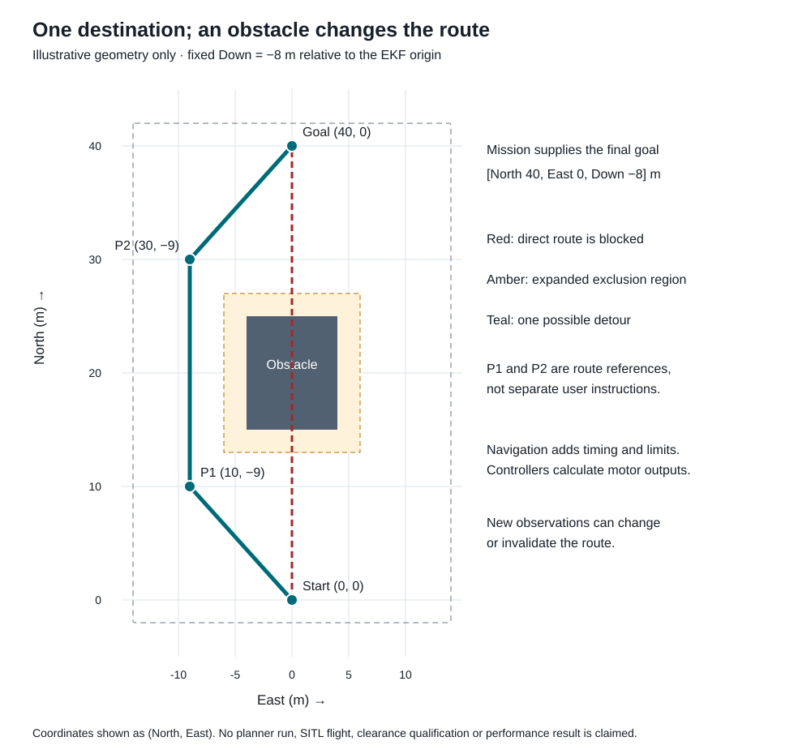

# Mission inputs path calculation and ArduPilot code

[Core architecture](../architecture/README.md) · [Master learning plan](../MASTER-LEARNING-PLAN.md)

[Core architecture diagram](../assets/architecture/ardupilot-code-stack.svg) · [Core architecture notes](../architecture/README.md)

Recorded 2026-10-31 for the user's request to show a mission's contents, required inputs, a path example and the corresponding ArduPilot code. This is a discovery walkthrough. Example data, native interfaces and numeric limits are illustrative; no mission loader, flight mode, qualified configuration or SITL run was implemented. Source links refer to inspected upstream revision `363ab1b5efdb67a0d0ade62984685b6d44d0f40d`, a research snapshot rather than the qualified project version. This page adds detail to the existing architecture and does not approve or deploy it.

## One mission and its inputs

Use a coordinate-and-hold task first: from an already airborne, qualified simulation state, navigate to North 40 m, East 0 m, Down −8 m relative to the bound EKF origin, then satisfy position/speed/dwell conditions and maintain the authorized hold. No takeoff, semantic target recognition or landing is hidden inside this example. Down −8 means 8 m above the EKF origin; it is not a terrain-clearance measurement.

The [complete illustrative mission JSON](../examples/mission-contract-and-path/coordinate-mission.json) contains an example schema marker, identity/backend, preconditions, origin/frame, task steps, motion and geographic limits, capability/freshness-profile references, deadline, completion conditions and fallback/terminal-policy references. It is our proposed mission format, not an ArduPilot parameter file, MAVLink mission-item list or format upstream already accepts. Unresolved profile references would have to reject execution in the future implementation.

| Input | Contents | Producer and lifetime |
| --- | --- | --- |
| Mission definition | Steps, final goal or target rule, coordinate conventions, motion/area limits, capability requirements, input-validity policy, completion and failure policy. | Operator/form or validated preparation tool; bounded configuration loaded before execution. |
| Qualified vehicle/runtime profile | Selected build/vehicle, estimator/sensors, control/navigation configuration, parameters, authority and mode integration. | Setup/qualification work; checked against mission requirements. |
| Live vehicle state | Estimated pose, velocity, attitude, health, authority and active mode, with valid time/frame semantics. | Existing ArduPilot estimator and vehicle state, continually updated. |
| Live obstacle evidence, when required | Range/proximity or suitable occupied/free/unknown-space representation, age, frame and quality. | Configured sensor/mapping integration; not a frozen list invented by the language model. |
| Target observations, only for object steps | Intended instance, target estimate, capture/receipt time, frame and uncertainty. | Optional qualified perception/localization; unnecessary for this coordinate example. |

Camera calibration, model configuration and map alignment belong to their selected producer profiles. The mission references those capabilities rather than embedding images, model weights or a competing copy of the vehicle estimator. A map, if used, needs a known alignment and usable localization.

## A concrete route illustration



[Open SVG](../examples/mission-contract-and-path/coordinate-mission-path.svg) · [Editable geometry JSON](../examples/mission-contract-and-path/path-geometry.json) · [Figure renderer](../examples/mission-contract-and-path/render_path_figure.py)

The user supplies the final goal, not every bend. The direct line from start to goal intersects an obstacle. The expanded exclusion rectangle represents vehicle extent, uncertainty and clearance. One possible detour uses local NED references `(10, −9, −8)` and `(30, −9, −8)` before the final `(40, 0, −8)`. All example numbers are unqualified. The rectangle is assumed occupied across the relevant flight-height slab; no claim is made that flying above or below it is possible.

This polyline is an explanatory drawing, not a route calculated by ArduPilot or observed in SITL. In the actual integration, route choice uses the accepted destination, current estimated state, obstacle evidence, configured planning behavior and operating limits. It can change as observations change. Curve smoothing must preserve clearance and dynamics; rounding corners without rechecking geometry is insufficient. A complete future route need not be available upfront when using a local avoidance method.

## What calculates the path

There are three different calculations:

1. **Route or intermediate destination:** determine where travel is feasible. For appropriate scenarios, qualify existing obstacle-avoidance facilities. BendyRuler examines candidate directions and clearance over a finite lookahead, with further checks for progress toward the destination. It is local planning and does not guarantee a global shortest route through arbitrary buildings. Dijkstra's documented avoidance uses configured fences/stay-out zones; it is not the same as avoiding live sensed objects.
2. **Motion reference:** determine how position, velocity and acceleration should evolve while following that route. In the inspected ordinary waypoint path, `AC_WPNav` builds/advances an S-curve leg using configured motion constraints. Avoidance branches can use different handoffs, so this is not a claim that every BendyRuler update runs the same S-curve path.
3. **Feedback control and output:** use current estimated state to follow the reference. Position control, attitude/rate control and motor mixing supply the vehicle's actual output demands. The mission selects goals/policy rather than individual motor speeds.

Obstacle appearance in a rendered world is not itself a sensor observation delivered to ArduPilot. Sensor transport, usable clearance evidence, mode integration and failure handling must be qualified. The mission deadline and arrival dwell are our task conditions, not automatically satisfied by accepting a waypoint or by a waypoint-reached flag.

## Where that appears in upstream source

These links were inspected at the pinned research snapshot. API names and meter/NED conventions here belong to that snapshot; older tutorials and qualified releases may expose different interfaces.

| Source | Specific responsibility visible in the code |
| --- | --- |
| [ModeGuided waypoint initialization](https://github.com/ArduPilot/ardupilot/blob/363ab1b5efdb67a0d0ade62984685b6d44d0f40d/ArduCopter/mode_guided.cpp#L208-L225) | Initializes waypoint navigation and starts from a stopping-point reference. |
| [ModeGuided waypoint update](https://github.com/ArduPilot/ardupilot/blob/363ab1b5efdb67a0d0ade62984685b6d44d0f40d/ArduCopter/mode_guided.cpp#L229-L248) | Checks ground/arming state, updates waypoint navigation, vertical control and attitude demand. |
| [Destination handling](https://github.com/ArduPilot/ardupilot/blob/363ab1b5efdb67a0d0ade62984685b6d44d0f40d/ArduCopter/mode_guided.cpp#L466-L500) | Checks destination/fence handling and selects the configured navigation path. |
| [AC_WPNav destination and trajectory](https://github.com/ArduPilot/ardupilot/blob/363ab1b5efdb67a0d0ade62984685b6d44d0f40d/libraries/AC_WPNav/AC_WPNav.cpp#L383-L434) | Sets the leg and creates its constrained trajectory. |
| [AC_WPNav update](https://github.com/ArduPilot/ardupilot/blob/363ab1b5efdb67a0d0ade62984685b6d44d0f40d/libraries/AC_WPNav/AC_WPNav.cpp#L713-L746) | Advances the reference and runs horizontal position control. |
| [AC_WPNav_OA update](https://github.com/ArduPilot/ardupilot/blob/363ab1b5efdb67a0d0ade62984685b6d44d0f40d/libraries/AC_WPNav/AC_WPNav_OA.cpp#L107-L151) | Requests an avoidance result through `AP_OAPathPlanner::mission_avoidance`; later branches handle the returned planner/state. |
| [BendyRuler direction search](https://github.com/ArduPilot/ardupilot/blob/363ab1b5efdb67a0d0ade62984685b6d44d0f40d/libraries/AC_Avoidance/AP_OABendyRuler.cpp#L141-L215) | Examines direction candidates and clearance, with lookahead and direction-change handling. |

The actual upstream waypoint controller contains these calls (comments omitted):

```cpp
copter.failsafe_terrain_set_status(wp_nav->update_wpnav());
pos_control->D_update_controller();
attitude_control->input_thrust_vector_heading(pos_control->get_thrust_vector(), auto_yaw.get_heading());
```

This is a small excerpt, not a complete runnable flight mode. Its surrounding upstream mode performs initialization and vehicle checks; scheduling, estimator readiness, spool handling, authority, failsafes and update semantics remain essential. The researched OA wrapper contains distinct error/processing/success handling and branch-specific reference updates. A new mode must deliberately use and qualify the intended path, rather than assume all stock GUIDED/AUTO behavior is inherited.

## How our proposed native code would connect

The sketch below illustrates responsibilities. `FL_Mission`, `ModeFeatherLane`, `mission.tick`, `collect_required_inputs`, `execute_qualified_policy`, `navigation_rejected` and `run_qualified_navigation_control_update` are our proposed names/helpers, not existing upstream APIs. It is deliberately incomplete and non-compilable as delivered; it is not flight implementation.

```cpp
// PROPOSED ownership sketch: after qualified mode entry and initialization.
void ModeFeatherLane::run()
{
    const auto decision = mission.tick(collect_required_inputs());

    if (decision.action != MissionAction::FollowGoal) {
        execute_qualified_policy(decision);
        return;
    }

    if (decision.has_new_accepted_goal) {
        // Real API name at the inspected research revision; units are NED meters.
        if (!wp_nav->set_wp_destination_NED_m(decision.goal_ned_m, false)) {
            navigation_rejected();
            return;
        }
    }

    run_qualified_navigation_control_update();
}
```

Our admission/tick must enforce the bound origin, navigation validity, applicable authority/vehicle state, fences/operating limits, required-input freshness, capability readiness and deadline. It owns measured arrival speed/position/dwell and reasons. The helper at the end represents a correctly initialized, qualified navigation/control path, including appropriate avoidance integration and existing vehicle checks; it is not a newly discovered upstream method. Set/update goals when accepted, not unconditionally on every camera frame.

A suitable module split remains the existing proposal: task logic in candidate `libraries/FL_Mission/`, vehicle glue in candidate `ArduCopter/mode_featherlane.cpp`, and scoped ingress/status integration. Standard coordinate routes may instead use supported AUTO/AP_Mission behavior; our custom mission JSON is not automatically an `AP_Mission` upload. Only the selected flight mode owns execution.

For the ice-cream-truck example, extend the steps to bounded transit/search, target verification, approach, site assessment and landing, with capabilities required per step. The goal is produced from perception at the appropriate step rather than stored as a known truck coordinate. Search and arbitrary landing-site selection remain discovery work described in [request-to-action notes](mission-request-execution.md).

## Status and qualification boundary

This walkthrough elaborates P03 known-goal motion and P05 obstacle-aware routing, with optional P04 perception. It does not mark a phase active or complete, change deployment, or claim qualified speed/clearance values. The core architecture is the maintained responsibility view; the route figure has its own editable geometry beside the example. Before implementation, choose the actual pinned build, profiles, schema/message mapping, lifecycle/scheduling, origin/reset behavior and scenario-specific failure policies. Existing user design/UI review requirements remain in force.

Official explanatory references: [position control/navigation](https://ardupilot.org/dev/docs/code-overview-copter-poscontrol-and-navigation.html), [BendyRuler constraints](https://ardupilot.org/copter/docs/common-oa-bendyruler.html), [Dijkstra constraints](https://ardupilot.org/copter/docs/common-oa-dijkstras.html).
